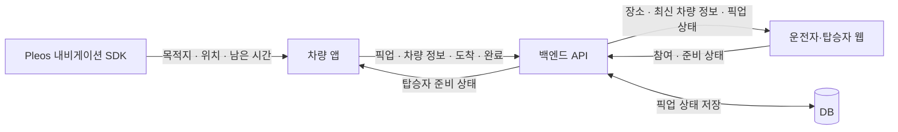

# 마중

**데리러 가는 사람과 기다리는 사람을 연결하는 차량 앱**

“어디쯤이야?” “지금 내려갈까?”

차량에서는 탑승자의 준비 상태를, 휴대전화에서는 차량의 위치와 도착까지 남은 시간을 확인합니다.

[시연 영상](docs/media/pickup-demo.mp4) · [구현 범위](#현재-구현-범위) · [전체 구조](#전체-구조) · [개발 저장소](#개발-저장소)

## 어떤 상황에서 쓰나요?

가족이나 지인을 데리러 갈 때, 운전자는 길을 보면서 도착 시간을 알려주고 탑승자는 언제 나갈지 다시 묻게 됩니다.
마중은 차량 내비게이션의 목적지·위치·남은 시간과 탑승자의 준비 상태를 한 픽업 안에서 주고받습니다.
탑승자가 위도·경도를 입력할 필요 없이 약속 장소와 차량 정보를 확인하고, 준비가 끝나면 차량에 알릴 수 있도록 만들고 있습니다.

## 사용 흐름

| 순서 | 운전자·차량 | 탑승자·휴대전화 |
| --- | --- | --- |
| 약속 만들기 | 내비게이션에서 만날 장소를 정하고 픽업 생성 | 초대받을 준비 |
| 초대·연결 | 초대 링크 전달, 참여 확인 | 링크로 참여 |
| 이동 중 | 탑승자가 준비됐는지 차량에서 확인 | 차량 위치·남은 시간 확인, 준비 상태 변경 |
| 도착·탑승 | 도착 알림 후 실제 탑승을 확인하고 완료 | 도착·공유 종료 상태 확인 |

차량 QR을 운전자 휴대전화로 스캔해 카카오톡 등으로 전달하는 방식과 이름 없는 자동 연결을 다음 흐름으로 정했습니다.
**현재 시연은 링크 복사·이름 입력·운전자 승인 방식**입니다. QR·공유 화면·자동 연결은 아직 이 영상에 포함되지 않습니다.

## 시연 영상

**[전체 흐름 보기 · 약 45초, 무음](docs/media/pickup-demo.mp4)**

생성 → 참여 → 승인 → 준비 완료 → 도착 → 탑승 확인·공유 종료를 담았습니다.
공식 Pleos 에뮬레이터의 차량 앱과 같은 Mac의 로컬 API·탑승자 웹을 연결한 녹화입니다.
분리 전 통합 버전의 영상으로, 이후 추가한 재실행 복구와 화면 밖 전송은 담고 있지 않습니다.
[촬영 조건과 재현 방법](docs/pickup-demo.md)에서 확인한 범위를 볼 수 있습니다.

SDK 연결 중단 전·후 화면 보기

실제 캡처 두 장을 반복하는 GIF입니다. 정상 수신 화면과 SDK 연결 해제 후 이전 정보가 숨겨지는 화면을 비교한 자료이며 연속 녹화는 아닙니다.

## 전체 구조

차량 SDK의 정보를 서버에 보내고 웹이 조회합니다. 탑승자 준비 상태는 반대 방향으로 전달합니다.
차량과 휴대전화가 직접 연결되는 방식은 아닙니다. 로컬 시험은 H2, 별도 서버 배포 구성은 PostgreSQL을 사용합니다.
차량 앱은 Pleos Android Automotive 앱이며, 운전자 휴대전화의 공유 화면과 탑승자 화면은 웹으로 개발합니다. 탑승자 전용 앱은 후속 범위입니다.

## 현재 구현 범위

2026년 10월 23일 기준입니다. 구현된 기능도 검증 환경과 반영 상태를 함께 표시합니다.

| 항목 | 상태·확인 범위 |
| --- | --- |
| 기본 픽업 | 에뮬레이터·로컬 API·웹에서 생성, 참여 승인, 준비 상태 전달, 도착·완료·취소 확인 |
| 위치·남은 시간 | 실제 SDK 응답과 API 값 대조, 연결 해제 시 이전 정보 숨김 확인 |
| 재실행 복구 | 암호화 저장, 서버 상태 재확인, 종료·권한 철회 시 삭제. [차량 PR #5](https://github.com/majung-team/majung-vehicle-app/pull/5) main 반영 |
| 화면 밖 공유·재개 확인 | 화면 중단 후 310초 전송·서버 취소 후 중단·재실행 후 재개 선택 확인. [차량 PR #7](https://github.com/majung-team/majung-vehicle-app/pull/7) main 반영 |
| 별도 서버 준비 | 전용 VM·PostgreSQL·재시작·백업 복구 확인. 공개 HTTPS·실제 휴대전화 연결은 미완료 |
| QR·자동 연결·지도 | 다음 구현 범위. 현재 시연 완료로 표시하지 않음 |
| 경유지·SDK 도착·주행 제한·음성 | SDK 연계와 플랫폼 조건 확인·구현이 필요한 범위 |

현재 검증은 차량 한 대·픽업 한 건·탑승자 한 명을 기준으로 합니다.
실차 주행, 시동 OFF/ON, 도로에서의 ETA 정확도, 플랫폼 심사 통과를 검증한 결과는 아닙니다.
개별 기능의 실행 방법과 시험 결과는 해당 개발 저장소에서 관리합니다.

## 개발 저장소

| 저장소 | 담는 내용 | 시작 위치 |
| --- | --- | --- |
| **[majung-vehicle-app](https://github.com/majung-team/majung-vehicle-app)** | 차량 화면, Pleos SDK, 위치·ETA 전송, SDK 진단 모듈 | [실행 안내](https://github.com/majung-team/majung-vehicle-app#실행) · [화면 구조](https://github.com/majung-team/majung-vehicle-app/blob/main/docs/vehicle-screen.md) |
| **[majung-web](https://github.com/majung-team/majung-web)** | 운전자 휴대전화 공유 화면·탑승자 웹 | [README](https://github.com/majung-team/majung-web#readme) |
| **[majung-backend](https://github.com/majung-team/majung-backend)** | 픽업 API, 권한·상태 관리, DB·배포 구성 | [README](https://github.com/majung-team/majung-backend#readme) |
| **majung · 이 저장소** | 서비스 소개, 전체 구조, 공통 기획·시연 자료, 분리 전 개발 기록 | [문서 안내](docs/README.md) |

새 기능은 각 개발 저장소의 이슈·브랜치·PR로 진행합니다.
이 저장소에 남아 있는 `vehicle/`, `server/`, `web/`, `probe/`, `design/prototype/`은 이전 통합 버전 기록입니다.
현재 앱을 실행하기 위해 이 경로를 수정하거나 빌드하지 않습니다. [이전 버전 안내](docs/archive/README.md)를 참고하세요.

## 팀

두 명이 기능별로 차량·웹·서버를 함께 개발합니다.
차량 SDK·재실행 복구·지속 전송·경유지·주행 표시와 참여·초대 공유·지도·외부 연결을 중심으로 역할을 분담하여 진행.
공통 API가 바뀌면 관련 저장소의 변경을 서로 연결해 검토합니다.

[기능별 계획과 역할](docs/revised-plan.md) · [기여 가이드](CONTRIBUTING.md) · [팀 노션](https://app.notion.com/p/4026da9ae26a805abd45c0ee5885ef2f)

공모전에서 자료를 확인하는 순서와 제출 전 남은 준비는 [제출 자료 안내](docs/submission-guide.md)에 정리합니다.
