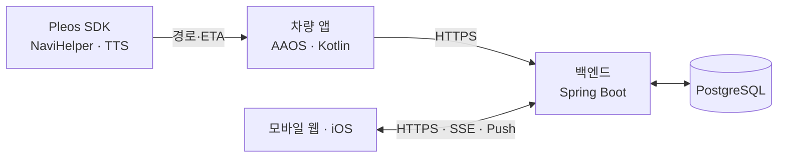

  
  <h1>마중 (Majung)</h1>
  
차량 내비게이션의 픽업 장소·위치·예상 도착 시간(ETA)과 탑승자의 준비 상태를 연결해 반복 연락을 줄이는 픽업 지원 서비스입니다.

  

    <a href="https://majung.cloud/account">모바일 웹</a> ·
    <a href="https://github.com/majung-team/majung-vehicle-app/releases/tag/v0.2.33-preview.20261112">차량 APK (0.2.33-preview)</a> ·
    <a href="https://github.com/majung-team/majung/raw/main/docs/media/pickup-demo.mp4">시연 영상 (1분 36초)</a> ·
    <a href="https://majung.cloud/api/swagger-ui/index.html">Swagger UI</a> ·
    <a href="docs/README.md">전체 문서</a>
  

---

## 1. 주요 기능

> **시연 영상 (1분 36초 · TTS 음성 포함)**: [영상 바로 보기](https://github.com/majung-team/majung/raw/main/docs/media/pickup-demo.mp4) · [촬영 환경 및 장면 안내](docs/pickup-demo.md)  
> *(차량 앱 `0.2.29-preview` + 운영 서버 `majung.cloud` 기준 Pleos 에뮬레이터 시연)*

- **1. 연결 · 요청**: 차량 QR 스캔이나 비회원 초대 링크로 간편하게 연결하고, 여러 요청은 대기열로 한 건씩 순차 진행합니다.
- **2. 내비 연동**: 기존 목적지를 유지한 채 픽업 장소를 경유지로 추가하고, 장소 변경 제안은 운전자 수락 시 경로에 바로 반영합니다.
- **3. 실시간 소통**: 매칭된 차량 위치·ETA와 탑승자 준비 상태(`[준비 중]` / `[탑승 준비 완료]`)·메시지를 공유하고 차량 TTS로 읽어 줍니다.
- **4. 안전 · 종료**: 주행 중 조작 제한(`CarUxRestrictions`), 내비 위 헤드업 알림, 반경 100m 자동 도착 감지를 지원하며 완료 시 위치 공유를 즉시 종료합니다.

---

## 2. 시스템 구성 및 기술 스택

> SSE는 상태 변경 신호만 가볍게 전달하며, 웹과 iOS 클라이언트는 신호 수신 또는 재연결 시 API를 다시 조회해 최신 상태를 맞춥니다.

- **차량 앱**: Kotlin · Android Automotive OS(AAOS) · Pleos NaviHelper 3.0.5 · Pleos TTS 3.3.1 · `CarUxRestrictions`
- **모바일 클라이언트**: 웹(HTML · CSS · JavaScript · Kakao Maps SDK) · iOS(SwiftUI · `@Observable` · MapKit)
- **백엔드 · 데이터**: Java 17(JDK 25) · Spring Boot 4.0.8 · Spring Security OAuth2 · PostgreSQL · Spring Session JDBC
- **실시간 · 알림**: Server-Sent Events(SSE) · Web Push(VAPID) · Apple APNs · 카카오 로컬/OAuth API
- **인프라 · 배포**: Caddy(HTTPS) · GitHub Actions · GCP VM(단일 VM Blue-Green)

---

## 3. 실행 방법 · 테스트 환경 · 검증 범위

**기준일: 2026년 11월 12일**

- **차량 APK 위치**: [`majung-vehicle-app/apk/마중_마중_release.apk`](https://github.com/majung-team/majung-vehicle-app/blob/main/apk/%EB%A7%88%EC%A4%91_%EB%A7%88%EC%A4%91_release.apk) · [GitHub Releases (0.2.33-preview)](https://github.com/majung-team/majung-vehicle-app/releases/tag/v0.2.33-preview.20261112)
- **실행 방법**:
  1. Pleos Connect 에뮬레이터에 `adb install -r 마중_마중_release.apk` 명령으로 차량 앱을 설치·실행합니다.
  2. 휴대전화로 차량 QR을 스캔해 [`https://majung.cloud/account`](https://majung.cloud/account) 페이지에서 운전자 계정을 연결합니다.
  3. 다른 카카오 계정(탑승자)이나 차량 초대 링크로 참여해 픽업 요청·수락·내비 연동·메시지 전달 흐름을 확인합니다.
- **Pleos 에뮬레이터 · 화면 규격**: `Pleos Connect v2.1.0` (`Android 14 / API 34`, `arm64-v8a`) · 디바이스 프로파일 `Pleos_Connect_v2_0` · **`2560 × 1440 px` (`160 dpi`)**
- **테스트 환경 · 필요한 설정**: Android `minSdk 28` / `targetSdk 34` · JDK 25 · Pleos `NaviHelper 3.0.5` · `TextToSpeech 3.3.1` · 공개 운영 서버(`https://majung.cloud`, 별도 키 설정 불필요) · 카카오 계정 2개 및 위치 권한 허용
- **검증 범위**: 백엔드·웹·iOS 자동화 테스트, Pleos 에뮬레이터(`0.2.29-preview` 시연 · `0.2.33-preview` 설치·QR 팝업) 및 운영 서버 연동 확인 *(실제 차량 주행, LTE 전환, 실기기 푸시, 앱마켓 심사는 별도)*

---

## 4. 관련 저장소 및 상세 문서

- **[majung](https://github.com/majung-team/majung)**: 전체 서비스 소개 · 설계 · 시연
- **[majung-vehicle-app](https://github.com/majung-team/majung-vehicle-app)**: AAOS 차량 앱 · Pleos SDK 연동 · [APK 파일 (`apk/`)](https://github.com/majung-team/majung-vehicle-app/blob/main/apk/%EB%A7%88%EC%A4%91_%EB%A7%88%EC%A4%91_release.apk)
- **[majung-web](https://github.com/majung-team/majung-web)**: 운전자 · 탑승자 모바일 웹 (`majung.cloud`)
- **[majung-ios](https://github.com/majung-team/majung-ios)**: SwiftUI iOS 모바일 앱
- **[majung-backend](https://github.com/majung-team/majung-backend)**: Spring Boot API 및 운영 배포
- **상세 문서**: [시스템 아키텍처](docs/architecture.md) · [개발 현황 및 PR 근거](docs/development-status.md) · [시연 안내](docs/pickup-demo.md) · [설치·테스트 안내](docs/team-testing.md) · [남은 작업](docs/remaining-work.md) · [개인정보 안내](https://majung.cloud/privacy)
