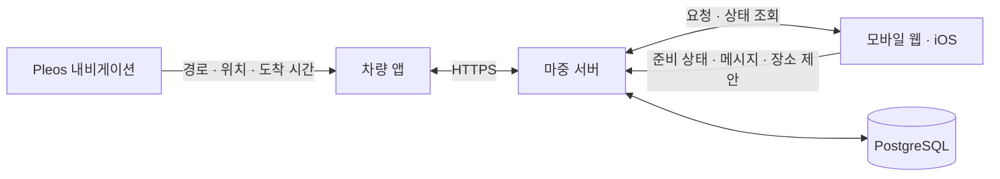

  
  <h1>마중</h1>
  
데리러 가는 사람과 기다리는 사람이 같은 픽업 정보를 볼 수 있도록.

  
<a href="https://majung.cloud/account">마중 웹</a> · <a href="https://github.com/majung-team/majung-vehicle-app/releases">차량 APK</a> · <a href="docs/pickup-demo.md">시연 영상</a> · <a href="https://github.com/majung-team/majung/wiki">기술 회고</a>

## 언제 내려가면 될까?

차로 데리러 가는 동안에는 “어디쯤이야?”, “지금 내려갈까?” 같은 연락을 주고받는다. 운전자는 길안내를 보고 있고, 탑승자는 언제 준비해야 할지 기다린다.

마중은 차량 내비게이션의 위치와 예상 도착 시간을 탑승자에게 보여준다. 탑승자가 준비 상태나 짧은 메시지를 보내면 운전자는 내비 화면 위 알림과 음성으로 확인한다. 만날 장소가 달라지면 탑승자가 제안하고, 운전자가 수락한 뒤 내비 경로에 반영한다.

| 운전자는 차량에서 | 탑승자는 휴대전화에서 |
| --- | --- |
| 내비 경로에서 만날 장소 확인 | 초대 링크로 앱 설치·가입 없이 참여 |
| 지인 초대 또는 받은 요청 수락 | 로그인 후 운전자를 찾아 마중 요청 |
| 내비를 보면서 준비 상태·메시지 수신 | 차량 위치·도착 시간 확인, 준비 완료·메시지 전송 |
| 장소 변경 확인, 도착·탑승 완료 처리 | 다른 장소 제안, 완료·취소 결과 확인 |

한 차량의 픽업은 한 번에 한 건씩 진행한다. 다음 탑승자에게 현재 픽업의 위치를 보여주지 않으며, 완료·취소 뒤에는 해당 픽업의 위치 공유를 끝낸다.

## 실제로 움직이는 흐름

**[내비 연동 시연 보기 · 1분 36초, 음성 포함](docs/media/pickup-demo.mp4)**

- **0:00–0:45** — 초대 참여 → 위치·도착 시간 → 준비 완료 → 도착·탑승 완료
- **0:45–1:19** — 내비를 보는 중 메시지·음성 수신 → 장소 제안 수락 → 경유지 변경
- **1:19–1:36** — 직접 초대·요청 대기열·주행 제한 등 구현 범위 소개

11월 10일 Pleos 공식 에뮬레이터와 운영 서버를 연결해 촬영한 기록이다. 촬영 APK는 `0.2.29-preview`, 최신 제출 APK는 **`0.2.36-preview` · versionCode 38**이다. [촬영 조건과 장면 설명](docs/pickup-demo.md)

## 차량·웹·서버는 이렇게 연결된다

내비 경로와 도착 시간은 차량 SDK에서 받는다. 서버는 권한과 데이터 유효성을 확인하고, 웹·iOS는 변경 신호를 받으면 API를 다시 조회한다. [전체 아키텍처](docs/architecture.md)

| 저장소 | 여기서 볼 내용 | 주요 기술 |
| --- | --- | --- |
| **[차량 앱](https://github.com/majung-team/majung-vehicle-app)** | 내비 연동·알림·주행 제한·앱 재실행 복구 | Kotlin · AAOS · NaviHelper · Pleos TTS |
| **[모바일 웹](https://github.com/majung-team/majung-web)** | 초대 참여·지도·준비 상태·장소 제안 | JavaScript · Kakao Maps · SSE |
| **[iOS](https://github.com/majung-team/majung-ios)** | 계정·초대·픽업 화면과 잠금화면 실시간 현황 | SwiftUI · MapKit · ActivityKit |
| **[백엔드](https://github.com/majung-team/majung-backend)** | 인증·픽업 상태·실시간 신호·배포와 백업 | Spring Boot · PostgreSQL · Caddy |

이 저장소는 서비스 소개와 시연, 설계·검증 문서를 모은 곳이다. 각 앱의 소스와 실행 방법은 해당 저장소에서 확인할 수 있다.

## 만들면서 풀었던 문제

| 글 | 출발점 |
| --- | --- |
| [경유지 좌표가 0으로 돌아왔다면?](https://github.com/majung-team/majung/wiki/Pleos-내비가-경유지-좌표-0을-돌려줄-때-경로는-어떻게-지킬까%3F) | 좌표는 없는데 장소 식별자와 도착 시간은 응답에 남아 있었다. |
| [내비를 켰더니 장소 추가가 멈췄다](https://github.com/majung-team/majung/wiki/앱이-꺼지거나-내비에서-돌아와도-픽업은-이어질까%3F) | 화면이 바뀐 경우와 앱이 종료된 경우를 어떻게 나눌까? |
| [서버는 32초 뒤 떴고, 배포는 30초 만에 실패했다](https://github.com/majung-team/majung/wiki/단일-VM-Blue-Green-배포와-예약-백업은-왜-중간에-멈췄을까%3F) | 코드 검사 밖에서 만난 배포·백업 문제들. |

[여섯 편 전체 읽기](https://github.com/majung-team/majung/wiki#기술-회고)

## 직접 실행해 보기

1. [차량 APK](https://github.com/majung-team/majung-vehicle-app/releases)를 Pleos 에뮬레이터에 설치한다.
2. 차량 QR을 휴대전화로 열고 카카오 계정을 연결한다.
3. 탑승자가 초대 링크에 참여하거나, 별도 계정으로 마중을 요청한다.

[차량 설치](https://github.com/majung-team/majung/wiki/차량-앱-설치) · [웹 이용](https://github.com/majung-team/majung/wiki/웹에서-시작하기) · [함께 테스트하기](docs/team-testing.md) · [API 명세](https://majung.cloud/api/swagger-ui/index.html)

> **실행 전 확인** — 11월 12일 공식 내비의 지도 초기화 실패를 관찰했다. 마중을 실행하지 않아도 재현됐으며, 수정본 적용으로 해결됐다고 확인한 상태는 아니다. [환경 오류와 문의 기록](https://github.com/majung-team/majung-vehicle-app/blob/main/docs/navigation-environment.md)

차량 시험 환경은 **Pleos Connect 2.1.0 · Android 14/API 34 · arm64-v8a · 2560×1440px/160dpi**, SDK는 **NaviHelper 3.0.5 · TextToSpeech 3.3.1**이다. 실제 차량 주행·시동 복구·실기기 푸시는 에뮬레이터 시험과 구분한다.

[개발·검증 기록](docs/development-status.md) · [남은 확인 사항](docs/remaining-work.md) · [전체 문서](docs/README.md) · [개인정보 안내](https://majung.cloud/privacy) · [기여 가이드](CONTRIBUTING.md)
