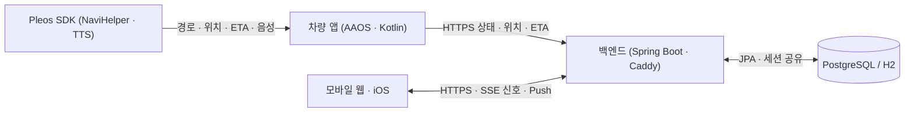

  
  <h1>마중 (Majung)</h1>
  
차량 내비게이션의 픽업 장소·실시간 위치·예상 도착 시간(ETA)과 탑승자의 준비 상태를 하나로 연결해, 마중 가는 과정의 반복 연락을 줄이는 픽업 지원 서비스입니다.

  

    <a href="https://majung.cloud/account">모바일 웹</a> ·
    <a href="https://github.com/majung-team/majung-vehicle-app/releases/tag/v0.2.30-preview.20261112">차량 APK (0.2.30-preview)</a> ·
    <a href="https://majung.cloud/api/swagger-ui/index.html">Swagger UI</a> ·
    <a href="https://github.com/majung-team/majung/wiki">Wiki</a> ·
    <a href="docs/development-status.md">개발 현황</a>
  

> 차량 앱은 Pleos Connect 공식 에뮬레이터(`0.2.30-preview`)와 SDK 기반으로 개발·검증 중이며, 실차 주행 및 앱마켓 심사는 아직 진행하지 않았습니다.

---

## 1. 시연 및 주요 기능

### 내비 연동 시연 (2026.11.10 · 차량 앱 0.2.29-preview)

- **[시연 영상 보기 (1분 36초 · 음성 포함)](https://github.com/majung-team/majung/raw/main/docs/media/pickup-demo.mp4)** · **[상세 촬영 안내](docs/pickup-demo.md)**
- **`0:00 ~ 0:45` 기본 픽업 흐름**: 차량 앱에서 만날 장소 확인 후 초대 → 탑승자 웹(`majung.cloud`) 참여 → 차량 위치·ETA 공유 및 준비 완료 전달 → 도착 알림·탑승 확인 후 공유 종료
- **`0:45 ~ 1:19` 내비 연동 및 장소 변경**: 탑승자의 **‘지금 내려가요’** 메시지 전송 및 차량 TTS 낭독 → **광교중앙역** 장소 변경 제안 → 내비 화면 알림에서 **‘수락 및 내비 변경’** 선택 시 기존 최종 목적지는 유지하고 경유지로 반영
- **`1:19 ~ 1:36` 기능·검증 요약**: 직접 초대, 다중 요청 대기열, 주행 중 조작 제한, 재실행 복구 및 공유 종료 흐름

> 공식 Pleos Connect 에뮬레이터(`0.2.29-preview`)와 운영 서버(`majung.cloud`)를 연결해 촬영한 시연이며, 실제 차량 주행 및 실기기 푸시 수신과는 다를 수 있습니다.

### 운전자 · 탑승자 연결 및 픽업 관리
- **QR 연결 · 초대**: 운전자는 차량 QR 승인만으로 계정을 연결하고, 탑승자는 지인 검색이나 회원가입 없는 초대 링크로 바로 참여할 수 있습니다.
- **요청 대기열 관리**: 여러 탑승자의 마중 요청을 대기열로 받되 한 번에 한 건씩 진행하며, 다른 픽업의 위치와 도착 시간은 노출하지 않습니다.

### 내비게이션 연동 및 장소 변경
- **Pleos 내비 연동**: 차량 내비의 목적지·경로·위치·ETA를 그대로 활용하며, 서버에서 자체 경로 계산을 수행하지 않습니다.
- **만날 장소 변경 제안**: 탑승자가 새 장소를 제안하면 차량 앱이 내비 경로를 확인하고, 운전자가 수락해 확정하기 전까지는 기존 장소를 유지합니다.

### 실시간 상태 공유 · 소통
- **위치 · ETA 공유**: 픽업이 시작되면 권한이 있는 탑승자에게 매칭된 차량 정보와 실시간 위치·예상 도착 시간을 전달합니다.
- **준비 상태 · 빠른 메시지**: 탑승자는 준비 상태를 알리거나 빠른 칩·직접 입력(최대 50자)으로 메시지를 보내 차량 화면 알림과 TTS 음성 안내로 바로 전달할 수 있습니다.

### 주행 안전 · 연결 복구
- **주행 제한 · 헤드업 알림**: 주행 중에는 읽기 전용 요약 화면으로 시선 분산을 줄이고, 내비 화면만 보는 중에도 신규 요청·장소 제안 헤드업 알림과 음성으로 안내합니다.
- **자동 도착 감지 · 종료·복구**: 목적지 반경 100m·잔여 30초 이내 진입 시 자동 도착을 알리며, 앱 강제 종료 후 재실행 시에도 사용자 확인 후 안전하게 재개하거나 종료합니다.

---

## 2. 시스템 구성 및 기술 스택

> SSE는 상태 변경 신호만 가볍게 전달하며, 웹과 iOS 클라이언트는 신호 수신 또는 재연결 시 필요한 API를 다시 조회해 최신 상태를 맞춥니다.

| 구분 | 구성 |
| --- | --- |
| **차량 앱** | Kotlin · Android Automotive OS (AAOS) · Pleos NaviHelper 3.0.5 · Pleos TTS 3.3.1 · CarUxRestrictions |
| **모바일 클라이언트** | 웹(HTML · CSS · JavaScript · Kakao Maps SDK) · iOS(SwiftUI · `@Observable` · MapKit) |
| **백엔드 · 데이터** | Java 17(JDK 25) · Spring Boot 4.0.8 · Spring Security OAuth2 · PostgreSQL · Spring Session JDBC |
| **실시간 · 알림** | Server-Sent Events(SSE) · Web Push(VAPID) · Apple APNs · 카카오 로컬/OAuth API |
| **인프라 · 배포** | Caddy(HTTPS) · GitHub Actions · GCP VM (단일 VM Blue-Green) |

---

## 3. 검증 범위 및 현황

**기준일: 2026년 11월 12일**

| 구분 | 범위 |
| --- | --- |
| **자동화 · 에뮬레이터 검증** | 백엔드·웹·iOS 단위/통합/계약/UI 테스트, Pleos 에뮬레이터(`0.2.29-preview` 시연 · `0.2.30-preview` 설치·QR 확인 팝업 반영) 검증, 모바일·아이폰 연동 확인, 운영 서버(`majung.cloud`) 배포 확인 |
| **실환경 별도 확인** | 실제 차량 주행 및 스피커 출력, LTE·Wi-Fi 네트워크 전환, 실기기 푸시 배너 동작, 앱마켓 입점 심사 |

- **알려진 제한 사항**: 에뮬레이터에서 SDK 경유지 원본 좌표 `0` 응답 우회 적용 중([차량 이슈 #13](https://github.com/majung-team/majung-vehicle-app/issues/13)), 가독성 기기 시험 종료 시 `ActivityScenario` PAUSED 대기([차량 이슈 #116](https://github.com/majung-team/majung-vehicle-app/issues/116))

---

## 4. 상세 문서 및 관련 저장소

| 분류 | 문서 |
| --- | --- |
| **설계 · 시연** | [시스템 아키텍처](docs/architecture.md) · [시연 촬영 안내](docs/pickup-demo.md) · [전체 문서 목록](docs/README.md) · [GitHub Wiki](https://github.com/majung-team/majung/wiki) |
| **개발 · 검증** | [개발 현황 및 PR 근거](docs/development-status.md) · [설치 및 테스트 안내](docs/team-testing.md) · [남은 작업](docs/remaining-work.md) |
| **정책 · 참여** | [개인정보 안내](https://majung.cloud/privacy) · [기여 규칙](CONTRIBUTING.md) |

| 저장소 | 역할 |
| --- | --- |
| [majung](https://github.com/majung-team/majung) | 전체 서비스 소개 · 설계 · 시연 |
| [majung-vehicle-app](https://github.com/majung-team/majung-vehicle-app) | AAOS 차량 앱 및 Pleos SDK 연동 |
| [majung-web](https://github.com/majung-team/majung-web) | 운전자 · 탑승자 모바일 웹 |
| [majung-ios](https://github.com/majung-team/majung-ios) | SwiftUI iOS 모바일 앱 |
| [majung-backend](https://github.com/majung-team/majung-backend) | Spring Boot API 및 운영 배포 |
