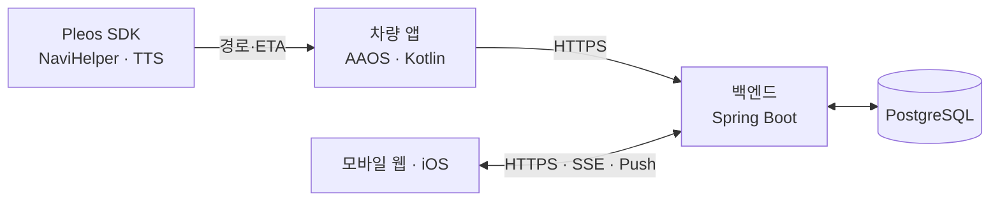

  
  <h1>마중 (Majung)</h1>
  
차량 내비게이션의 픽업 장소·위치·예상 도착 시간(ETA)과 탑승자의 준비 상태를 연결해 반복 연락을 줄이는 픽업 지원 서비스입니다.

  

    <a href="https://majung.cloud/account">모바일 웹</a> ·
    <a href="https://github.com/majung-team/majung-vehicle-app/releases/tag/v0.2.33-preview.20261112">차량 APK</a> ·
    <a href="https://github.com/majung-team/majung/raw/main/docs/media/pickup-demo.mp4">시연 영상</a> ·
    <a href="https://majung.cloud/api/swagger-ui/index.html">Swagger UI</a> ·
    <a href="https://github.com/majung-team/majung/wiki">Wiki</a> ·
    <a href="docs/README.md">전체 문서</a>
  

---

## 1. 주요 기능

> [!TIP]
> **내비 연동 시연 영상 (1분 36초 · TTS 음성 포함)**: [영상 바로 보기](https://github.com/majung-team/majung/raw/main/docs/media/pickup-demo.mp4) · [촬영 환경 및 장면 안내](docs/pickup-demo.md)  
> *(차량 앱 `0.2.29-preview` + 운영 서버 `majung.cloud` 기준 Pleos 에뮬레이터 시연 · 최신 배포 `0.2.33-preview`)*

| 단계 | 운전자 (차량 앱) | 탑승자 (웹 · iOS) |
| --- | --- | --- |
| **1.&nbsp;연결·요청** | 차량 QR 승인 · 지인 직접 초대 대기열 순차 처리 | 운전자 검색 요청 비회원 초대 링크 참여 |
| **2.&nbsp;내비&nbsp;연동** | 기존 목적지 유지 · 경유지 추가 변경 수락 확정 | 만날 장소 변경 제안 (확정 전 기존 유지) |
| **3.&nbsp;실시간&nbsp;소통** | 위치·ETA 전송 · 내비 위 알림 Pleos TTS 음성 안내 | 차량 위치·ETA 확인 준비 상태·메시지(50자) |
| **4.&nbsp;안전·종료** | `CarUxRestrictions` 요약 100m 도착 · 재개 확인 | 픽업 완료·취소 시 위치 공유 즉시 종료 |

---

## 2. 시스템 구성 및 기술 스택

> [!NOTE]
> SSE는 상태 변경 신호(`changed` / `refresh`)만 가볍게 전달하며, 웹과 iOS 클라이언트는 신호 수신 또는 재연결 시 REST API를 다시 조회해 최신 상태를 맞춥니다.

| 영역 | 구성 | 핵심 기술 |
| --- | --- | --- |
| **차량&nbsp;앱** | Android Automotive 앱 | Kotlin · AAOS · Pleos `NaviHelper 3.0.5` `TTS 3.3.1` · `CarUxRestrictions` |
| **클라이언트** | 모바일 웹 · iOS 앱 | 웹(HTML · CSS · JS · Kakao Maps) iOS(SwiftUI · MapKit · `AVFoundation`) |
| **백엔드** | API · 실시간 · 인증 | Java 17(JDK 25) · Spring Boot 4.0.8 OAuth2 · PostgreSQL · Spring Session JDBC |
| **인프라** | 알림 · 배포 · 운영 | SSE · Web Push(VAPID) · APNs · Caddy GitHub Actions · 단일 VM Blue-Green |

---

## 3. 실행 방법 · 테스트 환경 · 검증 범위

> [!IMPORTANT]
> **기본 내비 실행 제한 · 2026년 11월 12일 관찰**: Pleos Connect 2.1.0의 Navi42 `3.3.2-rc5-hotfix.3`이 지도 인증 응답의 `profile` 항목을 처리하지 못해 지도 초기화에 실패하는 현상을 확인했다. 마중을 실행하지 않은 콜드부팅에서도 재현됐다. 마중 APK 재설치나 NaviHelper 버전 변경으로 해결됐다고 확인한 상태는 아니며, 수정된 내비 APK·에뮬레이터 이미지와 적용 방법을 운영사무국에 문의했다. 11월 10일 정상 시연 기록과 이후 관찰한 환경 오류를 구분한다. [증상과 확인 범위](https://github.com/majung-team/majung-vehicle-app/blob/main/docs/navigation-environment.md).

> [!IMPORTANT]
> **기준일: 2026년 11월 12일** — 별도 서버 키 설정 없이 공개 운영 서버(`https://majung.cloud`)로 바로 연결해 테스트할 수 있습니다.

1. Pleos Connect 에뮬레이터에 `adb install -r 마중_마중_release.apk` 명령으로 차량 앱(`0.2.33-preview`)을 설치·실행합니다.
2. 휴대전화로 차량 QR을 스캔해 [`https://majung.cloud/account`](https://majung.cloud/account) 페이지에서 운전자 카카오 계정을 연결합니다.
3. 다른 카카오 계정(탑승자)이나 차량 초대 링크로 참여해 픽업 요청·수락·내비 연동·메시지 전달 흐름을 확인합니다.

| 항목 | 기준 사양 및 확인 범위 |
| --- | --- |
| **APK** | [`majung-vehicle-app/apk/마중_마중_release.apk`](https://github.com/majung-team/majung-vehicle-app/blob/main/apk/%EB%A7%88%EC%A4%91_%EB%A7%88%EC%A4%91_release.apk) [GitHub Releases (0.2.33-preview · versionCode 35)](https://github.com/majung-team/majung-vehicle-app/releases/tag/v0.2.33-preview.20261112) |
| **에뮬레이터** | `Pleos Connect v2.1.0` (`Android 14 / API 34`, `arm64-v8a`) 프로파일 `Pleos_Connect_v2_0` · **`2560 × 1440 px` (`160 dpi`)** |
| **실행 조건** | `minSdk 28` / `targetSdk 34` · JDK 25 · `NaviHelper 3.0.5` `TextToSpeech 3.3.1` · `majung.cloud` · 계정 2개 · 위치 권한 |
| **검증 범위** | 백엔드·웹·iOS 자동화, 에뮬레이터(`0.2.29` 시연·`0.2.33` 설치) *(실차 주행, LTE 전환, 실기기 푸시, 앱마켓 심사는 별도 검증)* |

---

## 4. 관련 저장소 및 상세 문서

| 저장소 | 담당 영역 |
| --- | --- |
| **[majung](https://github.com/majung-team/majung)** | 전체 서비스 소개 · 설계 · 시연 · [문서 전체 목록](docs/README.md) |
| **[majung-vehicle-app](https://github.com/majung-team/majung-vehicle-app)** | AAOS 차량 앱 · Pleos SDK · [APK 파일 (`apk/`)](https://github.com/majung-team/majung-vehicle-app/blob/main/apk/%EB%A7%88%EC%A4%91_%EB%A7%88%EC%A4%91_release.apk) |
| **[majung-web](https://github.com/majung-team/majung-web)** | 운전자 · 탑승자 모바일 웹 ([majung.cloud](https://majung.cloud)) |
| **[majung-ios](https://github.com/majung-team/majung-ios)** | SwiftUI · MapKit · `AVFoundation` iOS 앱 |
| **[majung-backend](https://github.com/majung-team/majung-backend)** | Spring Boot API · SSE · Blue-Green 운영 배포 |

| 문서 · Wiki | 안내 내용 |
| --- | --- |
| **[마중 Wiki 홈](https://github.com/majung-team/majung/wiki)** | 차량 설치·웹 사용법 및 [문제 해결·기술 회고 6편](https://github.com/majung-team/majung/wiki#7-%EB%AC%B8%EC%A0%9C-%ED%95%B4%EA%B2%B0%EA%B3%BC-%EA%B8%B0%EC%88%A0-%ED%9A%8C%EA%B3%A0) |
| **[시스템 아키텍처](docs/architecture.md)** | 차량·백엔드·웹·iOS 통신 구조 및 보안 설계 |
| **[개발 현황 및 PR 근거](docs/development-status.md)** | 일자별 릴리스·테스트 이력 및 기능별 PR 근거 |
| **[시연 안내](docs/pickup-demo.md) · [설치·테스트](docs/team-testing.md)** | 1분 36초 내비 연동 시연 장면 및 팀 테스트 절차 |
| **[남은 작업](docs/remaining-work.md) · [개인정보 안내](https://majung.cloud/privacy)** | 미검증 항목 계획 및 위치 정보 보관·파기 기준 |
