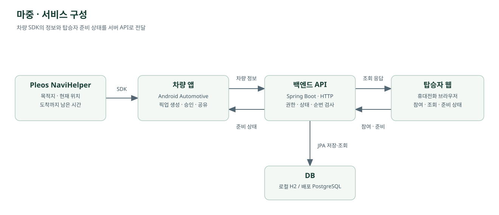

# 마중

**데리러 가는 사람과 기다리는 사람을 연결하는 차량 앱**

“어디쯤이야?” “지금 내려갈까?”

차량에서는 탑승자의 준비 상태를 보고, 탑승자는 휴대전화로 차량 위치와 남은 시간을 확인합니다.

[시연 영상](#시연-영상) · [구현 범위](#현재-구현-범위) · [전체 구조](#전체-구조) · [개발 저장소](#개발-저장소)

## 소개

누군가를 데리러 갈 때 “어디야?”, “지금 나갈까?” 같은 연락을 반복하게 됩니다.
마중은 차량 내비게이션의 위치·남은 시간과 탑승자의 준비 상태를 주고받는 앱입니다.
탑승자가 준비를 마치면 차량에서 확인하고, 차에 타면 픽업을 끝내 위치 공유를 종료합니다.

## 사용 흐름

| 순서 | 운전자·차량 | 탑승자·휴대전화 |
| --- | --- | --- |
| 약속 만들기 | 내비게이션에서 만날 장소를 정하고 픽업 생성 | 초대 링크 받기 |
| 초대·연결 | 초대 링크 전달, 참여 확인 | 링크로 참여 |
| 이동 중 | 탑승자가 준비됐는지 차량에서 확인 | 차량 위치·남은 시간 확인, 준비 상태 변경 |
| 도착·탑승 | 도착 알림 후 실제 탑승을 확인하고 완료 | 도착·공유 종료 상태 확인 |

**현재는 링크 복사 → 이름 입력 → 운전자 승인 순서로 연결합니다.**
QR을 운전자 휴대전화로 스캔해 초대를 보내고 이름 없이 연결하는 기능은 다음 작업입니다.

**추가 기획 · 2026-10-24:** 운전자 초대와 탑승자 요청을 함께 지원하고, 수락된 대기 요청에는 본인 순서·본인 장소까지 ETA를 제공하는 방향을 정했습니다. [픽업 시작 방식과 대기 요청](docs/pickup-request-flow.md)을 확인하세요. 기획 결정이며 구현 완료를 뜻하지 않습니다.

## 시연 영상

https://github.com/user-attachments/assets/3090606c-4212-4439-8da4-d6c45c02e819

약 45초, 무음. 생성 → 참여 → 승인 → 준비 완료 → 도착 → 탑승 확인까지 담았습니다.
공식 Pleos 에뮬레이터·로컬 API·웹으로 촬영한 분리 전 영상입니다. 이후 추가한 재실행 복구·화면 밖 공유는 영상에 없습니다.
[촬영 환경](docs/pickup-demo.md) · [MP4 원본 다운로드](https://github.com/majung-team/majung/raw/refs/heads/main/docs/media/pickup-demo.mp4)

SDK 연결 중단 전·후 화면 보기

SDK 연결 중·해제 후 화면을 캡처해 두 장으로 비교한 GIF입니다.

## 전체 구조

차량 앱과 웹은 서버 API로 연결합니다. 차량은 Pleos Android Automotive 앱, 탑승자 화면은 웹입니다.
서버는 SDK의 위치·남은 시간과 픽업 상태를 저장하고, 웹에서 보낸 준비 상태를 차량에 전달합니다.

**[상세 아키텍처](docs/architecture.md)** — 차량 서비스·화면·SDK·암호화 저장, 서버·웹 파일 구조, 로컬 실행과 배포 준비.

## 현재 구현 범위

2026-10-23 기준. 공식 에뮬레이터와 로컬 API·웹에서 확인했습니다.

| 항목 | 상태·확인 범위 |
| --- | --- |
| 기본 픽업 | 에뮬레이터·로컬 API·웹에서 생성, 참여 승인, 준비 상태 전달, 도착·완료·취소 확인 |
| 위치·남은 시간 | 실제 SDK 응답과 API 값 대조, 연결 해제 시 이전 정보 숨김 확인 |
| 재실행 복구 | 암호화 저장, 서버 상태 재확인, 종료·권한 철회 시 삭제. [차량 PR #5](https://github.com/majung-team/majung-vehicle-app/pull/5) main 반영 |
| 화면 밖 공유·재개 확인 | 화면 중단 후 310초 전송·서버 취소 후 중단·재실행 후 재개 선택 확인. [차량 PR #7](https://github.com/majung-team/majung-vehicle-app/pull/7) main 반영 |
| 별도 서버 준비 | 전용 VM·PostgreSQL·재시작·백업 복구 확인. 공개 HTTPS·실제 휴대전화 연결은 미완료 |
| QR·자동 연결·지도 | 개발 예정 |
| 경유지·SDK 도착·주행 제한·음성 | 개발 예정 |

현재는 차량 한 대·탑승자 한 명을 대상으로 시험했습니다. 실차 주행·시동 OFF/ON·플랫폼 심사·실제 휴대전화 시험은 남아 있습니다.

## 개발 저장소

| 저장소 | 담는 내용 | 시작 위치 |
| --- | --- | --- |
| **[majung-vehicle-app](https://github.com/majung-team/majung-vehicle-app)** | 차량 화면, Pleos SDK, 위치·ETA 전송, SDK 진단 모듈 | [실행 안내](https://github.com/majung-team/majung-vehicle-app#실행) · [화면 구조](https://github.com/majung-team/majung-vehicle-app/blob/main/docs/vehicle-screen.md) |
| **[majung-web](https://github.com/majung-team/majung-web)** | 운전자 휴대전화 공유 화면·탑승자 웹 | [README](https://github.com/majung-team/majung-web#readme) |
| **[majung-backend](https://github.com/majung-team/majung-backend)** | 픽업 API, 권한·상태 관리, DB·배포 구성 | [README](https://github.com/majung-team/majung-backend#readme) |
| **majung · 이 저장소** | 서비스 소개, 전체 구조, 공통 기획·시연 자료, 분리 전 개발 기록 | [문서 안내](docs/README.md) |

현재 코드는 위 세 개발 저장소에서 수정·실행합니다. 이 저장소의 `vehicle/`, `server/`, `web/` 등은 [분리 전 기록](docs/archive/README.md)으로 남겨뒀습니다.

## 팀

두 명이 차량·웹·서버를 기능별로 나눠 개발합니다. 담당과 작업 순서는 아래 계획 문서에 정리했습니다.

[기능별 계획과 역할](docs/revised-plan.md) · [기여 가이드](CONTRIBUTING.md) · [팀 노션](https://app.notion.com/p/4026da9ae26a805abd45c0ee5885ef2f)

[제출 자료 안내](docs/submission-guide.md)
