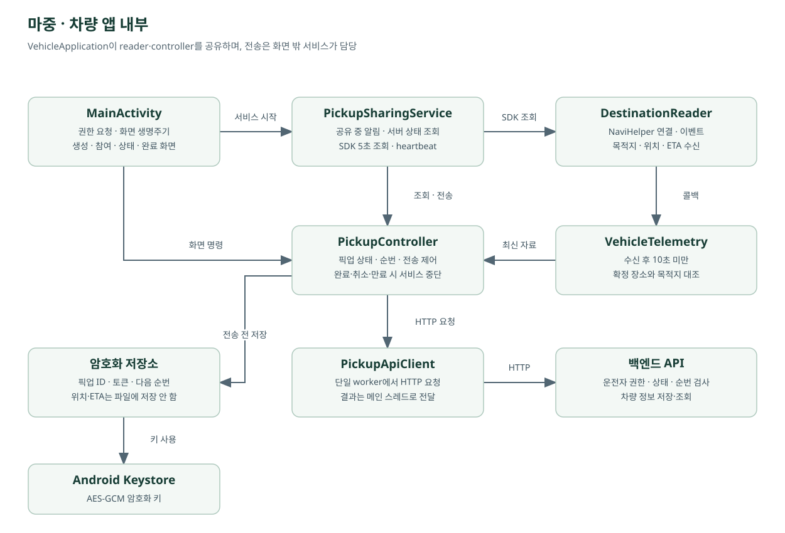

# 마중 (Majung) 시스템 아키텍처

**문서 기준일: 2026년 10월 30일**

마중은 차량 내비게이션의 경로·예상 도착 시간과 탑승자의 준비 상태를 연결하는 픽업 서비스다.

차량 앱, 백엔드 서버, 모바일 웹으로 구성되며, 운전자 초대와 탑승자 요청, 순차 픽업, 실시간 상태 공유를 지원한다.

이 문서는 실제 구현된 시스템 구조와 주요 데이터 흐름, 보안 및 운영 방식을 설명한다.

기능별 구현 근거와 검증 결과는 [개발 현황과 PR 대조](development-status.md)에서 확인할 수 있다.

---

## 1. 전체 시스템 구성


### 주요 구성 요소

| 구성 요소 | 기술 | 역할 |
| --- | --- | --- |
| 차량 앱 | Kotlin, Android Automotive OS | 픽업 관리, SDK 연동, 차량 화면 |
| 차량 플랫폼 | Pleos Connect | 내비게이션·TTS 등 차량 기능 제공 |
| 백엔드 | Spring Boot | 인증, 권한, 픽업 상태, 요청 대기열 |
| 데이터베이스 | PostgreSQL | 계정·픽업·세션 데이터 저장 |
| 모바일 웹 | HTML, CSS, JavaScript | 탑승자 요청, 위치·ETA·준비 상태 확인 |
| 실시간 갱신 | SSE, REST API | 변경 알림 및 최신 상태 조회 |
| 웹 서버 | Caddy | HTTPS, 정적 웹 제공, API 프록시 |
| 인프라 | GCP VM | 백엔드 및 웹 운영 |
| CI/CD | GitHub Actions | 서버·웹 자동 배포 |

### 통신 구조

```text
                  ┌─────────────────────┐
                  │  Pleos Connect SDK  │
                  │  경로 · 위치 · ETA   │
                  └──────────┬──────────┘
                             │
                             ▼
                  ┌─────────────────────┐
                  │    차량 앱 (AAOS)   │
                  │   Kotlin / Android  │
                  └──────────┬──────────┘
                             │ HTTPS
                             ▼
┌────────────────┐   ┌───────────────────┐
│   모바일 웹    │   │       Caddy       │
│                │◄─►│    HTTPS / API    │
│  요청·준비상태 │   └─────────┬─────────┘
│  위치·ETA 조회 │             │
└────────────────┘             ▼
                     ┌───────────────────┐
                     │    Spring Boot    │
                     │ 인증·픽업·SSE·상태│
                     └─────────┬─────────┘
                               │
                               ▼
                     ┌───────────────────┐
                     │    PostgreSQL     │
                     │ 픽업·계정·세션 저장│
                     └───────────────────┘
```

차량 앱과 모바일 웹은 동일한 HTTPS API를 사용한다.

차량 SDK에서 수신한 위치와 ETA를 백엔드에 전달하고, 서버는 권한과 데이터 유효성을 검증해 저장한다.

웹은 SSE로 변경 신호를 수신한 뒤 API를 다시 호출하여 최신 상태를 조회한다.

**WebSocket, Kafka, Redis는 사용하지 않는다.**

서버는 별도의 경로 탐색이나 교통 상황 분석을 수행하지 않으며, ETA의 원천은 차량 내비게이션 SDK다.

---

## 2. 픽업 요청 및 연결 구조

마중은 세 가지 방식으로 운전자와 탑승자를 연결한다.

### 2.1 QR 기반 초대

처음 만나는 탑승자에게 초대 링크를 전달하는 방식이다.

```text
차량에서 픽업 장소 확인
        ↓
QR 초대 생성
        ↓
운전자 휴대전화로 QR 열기
        ↓
탑승자에게 초대 링크 전달
        ↓
탑승자 링크 접속 및 참여
        ↓
픽업 시작 후 위치·ETA 공유
```

링크의 첫 참여자는 별도 계정 연결 승인 없이 해당 초대 픽업에 참여할 수 있다.

운전자는 차량에서 연결을 해제할 수 있다.

QR을 운전자 휴대전화로 열었다고 해서 탑승자가 자동으로 참여하는 것은 아니다.

### 2.2 탑승자 직접 요청

로그인한 탑승자가 운전자를 검색하고 장소와 함께 요청하는 방식이다.

```text
탑승자 카카오 로그인
        ↓
닉네임·마중 ID로 운전자 검색
        ↓
픽업 장소 선택
        ↓
RideRequest 생성
        ↓
차량에서 요청 확인 및 수락
        ↓
대기열 등록
        ↓
경로 검증 후 픽업 시작
```

운전자와 미리 연결된 관계가 없어도 픽업을 요청할 수 있다.

차량 등록과 운전자 계정 연결은 최초 한 번 진행한다.

### 2.3 연결된 탑승자 직접 초대

차량에 연결된 운전자가 기존 탑승자를 선택하는 방식이다.

```text
차량에서 연결된 사람 조회
        ↓
탑승자 선택 및 초대
        ↓
웹에서 받은 초대 확인
        ↓
탑승자 수락
        ↓
대기열 등록
        ↓
픽업 시작
```

기존 연결을 재사용하기 때문에 매번 QR코드를 전달할 필요가 없다.

### 2.4 RideRequest와 Pickup

`RideRequest`는 픽업 요청과 대기 상태를 관리한다.

수락된 요청은 대기열에 등록되며, 자신의 차례가 되면 실제 픽업을 관리하는 `Pickup`과 연결된다.

`Pickup`은 다음 정보를 관리한다.

- 픽업 참여자와 접근 권한
- 확정된 픽업 장소
- 차량 위치와 예상 도착 시간
- 탑승자의 준비 상태
- 차량 도착 상태
- 탑승 완료 및 취소 상태

차량 한 대에 연결된 운전자 계정은 한 명을 기준으로 하며, 여러 탑승자 요청은 별도로 관리한다.

실제 진행 중인 픽업은 한 건만 유지한다.

[서버 픽업 요청 구조](https://github.com/majung-team/majung-backend/blob/main/docs/ride-requests.md)

---

## 3. 차량 앱 내부 아키텍처



차량 앱은 화면 표시, SDK 정보 조회, 서버 통신, 픽업 상태 및 복구 처리를 분리하여 구성했다.

### 3.1 화면과 백그라운드 서비스

`MainActivity`는 화면과 사용자 조작을 관리한다.

화면이 내려가면 화면 갱신은 중단되지만, 픽업 공유가 진행 중인 경우 `PickupSharingService`가 SDK 연결과 서버 통신을 유지한다.

| 항목 | 동작 |
| --- | --- |
| 서버 상태 확인 | 약 3초 간격 |
| SDK 위치·목적지 조회 | 약 5초 간격 |
| 차량 정보 전송 | 최소 5초 간격 |
| 서비스 실행 상태 | `ACTIVE`, `ARRIVED` |
| 서비스 종료 조건 | 완료, 취소, 만료 등 |

`PickupSharingService`는 픽업 상태를 확인하며, 종료 조건이 충족되면 SDK 연결과 관련 알림을 정리한다.

### 3.2 VehicleTelemetry

`VehicleTelemetry`는 차량 SDK에서 전달된 위치와 ETA를 관리한다.

위치와 ETA는 서로 다른 시점에 수신될 수 있으므로, 유효한 정보인지 확인한 뒤 함께 사용한다.

전송 조건은 다음과 같다.

- 위치와 ETA가 모두 수신된 상태
- 각 정보의 수신 후 경과 시간이 10초 미만
- ETA 목적지가 확정된 픽업 장소와 일치
- 현재 장소 버전에 해당하는 정보
- 이전 요청과의 중복 실행 방지

정차 중 동일한 값이 반복되더라도 유효한 정보라면 전송할 수 있다.

다만 오래된 자료의 수신 시각을 현재 시각으로 변경하지 않는다.

### 3.3 전송 순번 및 중복 방지

`PickupController`는 차량 정보 전송에 사용하는 순번과 요청 상태를 관리한다.

- 이전 전송 요청이 끝나기 전 다음 요청 중복 실행 방지
- 전송 순번 관리
- 상태 변경 및 접근 권한 확인
- 재연결 시 서버 상태와 순번 대조

순번은 HTTP 요청 전에 저장하여 재실행 이후에도 전송 순서를 관리할 수 있도록 구성했다.

---

## 4. 차량 앱 종료 및 복구

앱 화면 종료와 프로세스 종료는 구분한다.

### 4.1 화면이 내려간 경우

진행 중인 픽업이 있다면 `PickupSharingService`가 SDK 정보 공유를 유지한다.

화면이 다시 표시되면 서버 상태를 확인하고 화면을 갱신한다.

### 4.2 앱 프로세스가 종료된 경우

```text
차량 앱 재실행
       ↓
암호화된 접근 정보 확인
       ↓
서버에 픽업 상태 조회
       ↓
┌───────────────────────────┐
│ 진행 중인 픽업이 있는가? │
└─────────────┬─────────────┘
              │
       ┌──────┴──────┐
       │             │
      있음          없음
       │             │
       ▼             ▼
  재개·취소 선택   저장 정보 정리
       │
       ▼
  사용자가 재개 확인
       │
       ▼
  SDK 재연결 및 새 정보 전송
```

진행 중인 픽업이 확인되면 사용자가 **이전 픽업 계속하기** 또는 **픽업 취소**를 선택한다.

사용자가 재개하기 전에는 위치 공유를 자동으로 다시 시작하지 않는다.

이미 종료된 픽업이거나 서버에서 접근 권한을 거절하면 관련 저장 정보를 삭제한다.

일시적인 네트워크 오류라면 저장 정보를 유지하고 상태 조회를 재시도한다.

### 4.3 암호화 저장

차량 앱에서 복구를 위해 저장하는 정보는 다음과 같다.

- 픽업 ID
- 운전자 접근 토큰
- 유효한 초대 토큰
- 마지막 전송 순번

차량의 위치와 ETA는 복구 파일에 저장하지 않는다.

저장 정보는 AES-GCM으로 암호화하며, 암호화 키는 Android Keystore에서 관리한다.

암호화된 데이터는 백업 제외 경로에 저장하고 파일 교체 및 삭제 과정의 일관성을 관리한다.

### 4.4 복구 범위의 한계

앱 재실행 후 복구와 차량 시동 OFF/ON 처리는 별개다.

현재 구조는 다음 동작을 보장하는 것으로 설명하지 않는다.

- 강제 중지 이후 자동 실행
- 차량 시동 재시작 시 자동 픽업 재개
- 내비게이션 경로 안내 자동 재시작

실제 시동 OFF/ON 및 장시간 실행 동작은 별도 검증 대상이다.

[저장 및 복구 설계](https://github.com/majung-team/majung-vehicle-app/blob/main/docs/pickup-recovery.md)

[백그라운드 공유 구조](https://github.com/majung-team/majung-vehicle-app/blob/main/docs/background-sharing.md)

---

## 5. 차량 앱 주요 파일

기준 경로:

`majung-vehicle-app/vehicle/src/main/java/app/majung/vehicle/`

| 파일 | 역할 |
| --- | --- |
| `VehicleApplication.kt` | Reader·Controller 생성, 암호화 저장소 연결, 초기 복구 |
| `MainActivity.kt` | 화면 생명주기, 메뉴 전환, 권한 및 복구 처리 |
| `VehicleViews.kt` | 공통 UI, 버튼, 입력, 팝업 및 조작 제한 |
| `VehicleAccountController.kt` | 운전자 계정 및 연결 상태 관리 |
| `VehicleAccountSection.kt` | 계정·요청·사람 연결 화면 |
| `RequestPickupFlow.kt` | 요청 장소의 경로 준비, 검증 및 픽업 시작 |
| `PickupCreationSection.kt` | 픽업 생성 및 초대 |
| `PickupParticipantSection.kt` | 참여자 및 초대 승인 |
| `PickupStatusSection.kt` | 픽업 상태 표시 |
| `PickupCompletionSection.kt` | 도착, 완료 및 취소 |
| `PickupSharingService.kt` | 백그라운드 SDK 조회, 전송 및 종료 감지 |
| `DestinationReader.kt` | SDK 연결, 이벤트, 조회 및 연결 세대 확인 |
| `VehicleTelemetry.kt` | 위치·ETA 수신 시각과 목적지 일치 검사 |
| `PickupController.kt` | 픽업 상태, 권한, 순번 및 전송 중복 관리 |
| `PickupApiClient.kt` | JSON 및 Bearer 토큰 기반 HTTP 통신 |
| `PickupSessionStore.kt` | 픽업 복구 데이터 저장 인터페이스 |
| `EncryptedPickupSessionStore.kt` | 암호화 저장, 원자적 파일 교체 및 삭제 |

[차량 화면 구조](https://github.com/majung-team/majung-vehicle-app/blob/main/docs/vehicle-screen.md)

---

## 6. 백엔드 아키텍처

백엔드는 Spring Boot를 기반으로 계정, 차량 연결, 픽업 요청, 상태 관리 및 데이터 정리를 처리한다.

### 주요 패키지 및 파일

```text
majung-backend/
└── src/main/
    ├── java/app/majung/server/
    │   ├── MajungServerApplication.java
    │   └── pickup/
    │       ├── PickupApi.java
    │       ├── PickupEventsApi.java
    │       ├── PickupEventStreams.java
    │       ├── PickupService.java
    │       ├── Pickup.java
    │       ├── PickupRepository.java
    │       ├── AccountApi.java
    │       ├── MemberService.java
    │       ├── VehicleAccountService.java
    │       ├── RideRequestService.java
    │       ├── TokenService.java
    │       └── PickupRetentionJob.java
    └── resources/

deploy/
```

### 주요 역할

| 구성 요소 | 역할 |
| --- | --- |
| `PickupApi` | 픽업 HTTP 요청 및 응답 |
| `PickupEventsApi` | SSE 연결 요청 |
| `PickupEventStreams` | 인증된 상태 변경 신호 전달 |
| `PickupService` | 픽업 권한·상태·순번·시간 검증 |
| `Pickup` | 픽업 및 참여자, 최신 차량 정보 관리 |
| `PickupRepository` | DB 저장·조회 및 행 잠금 |
| `AccountApi` | 계정 관련 API |
| `MemberService` | 카카오 계정·검색·사람 연결 |
| `VehicleAccountService` | 차량 QR 및 운전자 계정 연결 |
| `RideRequestService` | 탑승자 요청·대기열·Pickup 연결 |
| `TokenService` | 토큰 발급 및 해시 비교 |
| `PickupRetentionJob` | 만료·종료 데이터 정리 |

### 6.1 상태 변경과 동시성

동일한 픽업에 대한 변경은 데이터베이스 트랜잭션과 행 잠금을 활용해 처리한다.

`sequence`를 사용하여 중복되거나 역순으로 도착한 변경 요청을 구분한다.

픽업 과정에서는 다음 상태를 별도로 관리한다.

- 탑승자 준비 완료
- 차량 도착
- 실제 탑승 완료

준비 완료가 곧 차량 도착을 의미하지 않으며, 차량 도착만으로 픽업을 자동 완료하지 않는다.

### 6.2 토큰 및 접근 권한

서버는 역할과 참여 방식에 따라 접근 권한을 구분한다.

- 운전자 권한
- 초대 링크 참여 권한
- 탑승자 권한
- 계정 세션 권한

픽업 접근 토큰은 원문 대신 해시를 저장하고 비교한다.

다른 픽업의 위치 및 상태 정보가 권한 없는 사용자에게 제공되지 않도록 서버에서 접근 권한을 검사한다.

---

## 7. 모바일 웹 아키텍처

모바일 웹은 별도의 프론트엔드 저장소에서 관리한다.

현재는 네이티브 탑승자 앱 없이 웹브라우저를 통해 픽업에 참여할 수 있다.

### 주요 파일

```text
majung-web/
├── index.html
├── style.css
├── app.js
├── stream.js
├── model.js
├── api.js
├── account.html
├── account.js
├── account-api.js
└── dev-server.mjs
```

| 파일 | 역할 |
| --- | --- |
| `index.html` | 초대 및 픽업 화면 |
| `style.css` | 공통 UI 스타일 |
| `app.js` | 픽업 참여, 준비 상태, 화면 처리 |
| `stream.js` | SSE 연결, 재연결 및 상태 재조회 |
| `model.js` | 화면 상태 및 데이터 만료 판단 |
| `api.js` | 픽업 관련 API 요청 |
| `account.html` | 계정 및 사람 연결 화면 |
| `account.js` | 로그인, 검색, 차량 연결 및 요청 |
| `account-api.js` | 계정 세션 및 CSRF 요청 |
| `dev-server.mjs` | 로컬 웹 서버 및 API 프록시 |

### 인증과 브라우저 저장소

기존 초대 픽업의 참여 정보는 브라우저 탭의 `sessionStorage`를 사용한다.

카카오 계정 로그인은 HttpOnly 세션 쿠키 기반으로 처리한다.

상태 변경 요청에는 CSRF 토큰을 사용한다.

차량의 접근 권한이나 카카오 인증 비밀정보는 브라우저 저장소에 보관하지 않는다.

Spring Boot JAR에서 정적 웹 파일을 함께 제공하던 초기 통합 구조와 달리, 현재 웹은 독립된 저장소에서 개발·배포한다.

---

## 8. SSE 기반 실시간 상태 동기화

마중은 WebSocket이나 별도 이벤트 브로커 대신 SSE와 REST API를 조합한다.

### 데이터 흐름

```text
차량 SDK
   │
   │ 위치·ETA
   ▼
차량 앱
   │
   │ HTTPS 전송
   ▼
Spring Boot
   │
   ├── 권한·순번·시간 검사
   │
   ▼
PostgreSQL
   │
   │ 상태 변경
   ▼
SSE 변경 신호
   │
   ▼
모바일 웹
   │
   │ 최신 상태 API 재조회
   ▼
화면 갱신
```

### 서버 측

- 픽업 상태를 DB에 저장
- 약 1초 간격으로 변경 여부 확인
- 변경된 픽업에 대해 SSE 신호 전달
- 연결 중 참여 권한과 로그인 세션 확인
- 종료 또는 접근 권한 해제 시 스트림 정리

SSE 메시지에는 차량 좌표나 인증 토큰을 직접 포함하지 않는다.

### 웹 측

- SSE 변경 신호 수신
- 인증된 API로 최신 상태 재조회
- 응답 데이터의 유효성 확인
- 화면 및 ETA 갱신
- SSE 연결 중단 시 재연결 또는 기존 조회 방식 사용

SSE는 상태 변경을 알리는 역할이며, 실제 최신 정보의 기준은 서버 API 응답이다.

---

## 9. 위치·ETA 유효성 관리

차량 정보는 SDK에서 수신한 자료를 그대로 무조건 공개하지 않는다.

서버와 웹에서 정보의 시각, 목적지, 장소 버전 및 접근 권한을 검증한다.

### 기본 유효 시간

| 항목 | 기준 |
| --- | --- |
| 차량 앱의 위치·ETA 조합 | 수신 후 10초 미만 |
| 차량 정보 서버 유효 시간 | 기본 30초 |
| 초대 유효 시간 | 기본 15분 |
| 픽업 유효 시간 | 기본 2시간 |
| 미응답 마중 요청 | 기본 30분 |
| 수락 후 대기 | 기본 2시간 |

값은 해당 버전의 기본 설정을 설명하며, 실제 운영 설정은 배포 환경에서 확인한다.

서버는 SDK 정보의 수신 시각과 서버 수신 시각을 바탕으로 만료 시점을 계산한다.

각 기준 중 더 이른 만료 시점을 적용하여 오래된 정보를 현재 상태로 사용하지 않도록 처리한다.

정보가 만료되면 API 응답에서 해당 위치와 ETA를 숨긴다.

### 데이터 보관 및 파기

만료되거나 종료된 픽업 관련 데이터는 설정된 보관 기간이 지난 뒤 정리 작업을 통해 삭제한다.

현재 아키텍처 기록에는 기본 보관 기간이 24시간으로 정리되어 있다.

다만 다른 개발 문서에는 종료 후 7일 보관 정책도 기록되어 있으므로, **데이터 종류별 보관 대상과 현재 운영 설정을 대조해야 한다.**

최종 보관 기간은 실제 서버 설정, 정리 작업 및 개인정보 안내 문서와 일치하도록 관리한다.

---

## 10. 장소 제안 및 변경 확정

마중은 탑승자의 장소 제안과 운전자의 최종 확정을 구분한다.

### 처리 흐름

```text
탑승자 장소 변경 제안
          ↓
서버에 제안 정보 저장
          ↓
차량에 별도 제안 카드 표시
          ↓
차량 SDK 경로·ETA 검증
          ↓
운전자 장소 변경 확정
          ↓
서버 장소 버전 증가
          ↓
이전 장소의 차량 정보 무효화
          ↓
새 장소 기준 위치·ETA 수신
          ↓
모바일 웹 화면 갱신
```

탑승자가 장소를 제안했다는 이유만으로 현재 픽업 장소가 즉시 변경되지는 않는다.

차량에서 새 경로를 확인하고 운전자가 확정해야 장소 버전이 변경된다.

### 장소 버전 관리

서버는 확정된 장소에 버전을 부여한다.

장소가 변경되면 다음과 같이 처리한다.

- 장소 버전 증가
- 기존 위치 및 ETA 무효화
- 이전 버전의 차량 정보 거절
- 이전 버전의 도착 요청 거절
- 새 장소와 일치하는 SDK 자료만 사용

웹에서도 장소와 차량 정보의 버전이 일치하지 않으면 위치 및 ETA를 표시하지 않는다.

이를 통해 이전 장소의 도착 시간이 새로운 장소의 ETA로 잘못 제공되는 상황을 방지한다.

---

## 11. 로컬 개발 환경

| 구성 | 로컬 환경 |
| --- | --- |
| 차량 앱 | Pleos 공식 에뮬레이터 |
| 백엔드 | Spring Boot |
| 데이터베이스 | H2 |
| 모바일 웹 | Node 기반 개발 서버 |
| API 연결 | 로컬 웹 서버의 `/api` 프록시 |
| 차량 SDK | 공식 SDK 및 에뮬레이터 환경 |

로컬 웹 개발 서버는 `/api` 요청을 Spring Boot로 전달한다.

차량 앱은 로컬 개발용 API 또는 명시적으로 지정한 공개 HTTPS API에 연결할 수 있다.

상세 빌드 및 실행 명령은 [팀 테스트 안내](team-testing.md)를 참고한다.

---

## 12. 운영 환경 및 배포

### 운영 인프라

| 구성 | 운영 환경 |
| --- | --- |
| 클라우드 | Google Cloud Platform |
| 서버 | 마중 전용 VM |
| 백엔드 | Spring Boot |
| 데이터베이스 | PostgreSQL |
| 웹 서버 | Caddy |
| 외부 주소 | https://majung.cloud |
| 보안 통신 | HTTPS |
| 배포 | GitHub Actions |
| 차량 앱 | 서명 APK 별도 빌드·설치 |

Caddy는 정적 웹 파일을 제공하고 `/api/` 요청을 Spring Boot로 전달한다.

데이터베이스 접속 정보, 카카오 인증 비밀 값 및 관리자 권한은 서버 환경변수로 관리한다.

GitHub Actions는 GCP 단기 인증과 제한된 배포 권한을 사용한다.

### Blue-Green 배포

백엔드는 동일 VM 내부에서 Blue와 Green 슬롯을 사용한다.

```text
                  GitHub Actions
                         │
                         ▼
                  새 버전 배포
                         │
                         ▼
                   후보 슬롯
                Blue 또는 Green
                         │
                         ▼
                Health·DB·세션 확인
                         │
                         ▼
                  Caddy 대상 전환
                         │
                         ▼
                    공개 API
```

| 슬롯 | 내부 포트 |
| --- | --- |
| Blue | 8081 |
| Green | 8082 |

배포 과정은 다음과 같다.

1. 기존 활성 슬롯 유지
2. 반대 슬롯에 새 버전 실행
3. 후보 서버의 DB·세션 테이블 확인
4. 커밋 및 슬롯 상태 검증
5. Caddy 연결 대상 전환
6. 공개 서비스 정상 동작 확인
7. 이전 슬롯 종료

후보 서버에 문제가 있다면 기존 연결 대상을 유지하거나 복구한다.

로그인 세션은 PostgreSQL의 Spring Session 테이블을 공유한다.

픽업 만료 및 데이터 파기 작업은 선택된 활성 슬롯에서만 수행하도록 구성했다.

내부 애플리케이션 포트는 외부에 직접 공개하지 않는다.

### 배포 범위와 한계

현재 Blue-Green은 애플리케이션 버전 전환을 위한 구조다.

서버 VM과 PostgreSQL 자체는 이중화하지 않았다.

배포 전환 중 SSE 연결은 끊겼다가 다시 연결될 수 있으며, 웹은 서버의 최신 상태를 다시 조회한다.

서버·웹은 각각 독립된 저장소의 `main` 브랜치에서 배포한다.

차량 앱은 GitHub에 코드가 반영되더라도 실제 설치된 APK가 자동으로 변경되지 않으므로 별도 빌드 및 설치가 필요하다.

[운영 버전 및 실제 배포 전환 기록](runtime-2026-10-29.md)

[Blue-Green 배포·복구 가이드](https://github.com/majung-team/majung-backend/blob/main/docs/blue-green.md)

---

## 13. 현재 검증 범위

### 수행한 검증

- 공식 에뮬레이터와 로컬 API에서 픽업 생성부터 탑승 완료까지 확인
- 화면이 내려간 상태에서 약 310초 동안 최신 차량 정보 유지 확인
- 서버 취소 후 백그라운드 공유 서비스 종료 확인
- 앱 재실행 및 복구 흐름 확인
- 사용자 재개 확인 전 위치 미전송
- 재개 후 전송 순번 유지 및 종료 후 저장 정보 삭제
- 공개 HTTPS에서 기존 초대 픽업 API 확인
- 차량 앱 및 SDK 연동 시험
- 실제 카카오 로그인과 세션 유지 확인
- 신규 요청을 가상 계정 3명 및 로컬 API·브라우저·차량 계측으로 시험
- Blue-Green 배포와 공유 세션 관련 시험

### 추가 검증이 필요한 항목

- 실제 휴대전화의 전체 픽업 흐름
- 실제 GPS 및 위치 권한 처리
- 여러 실제 탑승자 계정의 순차 픽업
- LTE·Wi-Fi 전환
- 실제 휴대전화 푸시 알림
- SDK 자동 도착 이벤트
- 차량 시동 OFF/ON
- 실제 차량의 주행 제한 및 TTS
- 플랫폼 배포·입점 심사

에뮬레이터와 로컬 API의 시험 결과는 실제 차량 검증을 대체하지 않는다.

---

## 14. 관련 문서

### 전체 시스템

- [프로젝트 README](https://github.com/majung-team/majung)
- [개발 현황과 PR 근거](development-status.md)
- [팀 테스트 안내](team-testing.md)
- [운영 버전 및 배포 기록](runtime-2026-10-29.md)
- [남은 작업](remaining-work.md)

### 차량 앱

- [차량 화면 구조](https://github.com/majung-team/majung-vehicle-app/blob/main/docs/vehicle-screen.md)
- [계정 및 픽업 요청](https://github.com/majung-team/majung-vehicle-app/blob/main/docs/vehicle-account-requests.md)
- [저장 및 복구](https://github.com/majung-team/majung-vehicle-app/blob/main/docs/pickup-recovery.md)
- [백그라운드 공유](https://github.com/majung-team/majung-vehicle-app/blob/main/docs/background-sharing.md)

### 백엔드 및 운영

- [픽업 요청 API](https://github.com/majung-team/majung-backend/blob/main/docs/ride-requests.md)
- [Blue-Green 배포·복구](https://github.com/majung-team/majung-backend/blob/main/docs/blue-green.md)

### 이전 설계

- [통합 구조 아카이브](archive/integrated-architecture.md)

기존 통합 아키텍처 문서는 당시의 구조를 보존하기 위한 기록이며 현재 운영 구조와는 다를 수 있다.

---

## 다이어그램 관리

아키텍처 다이어그램은 다음 스크립트로 다시 생성할 수 있다.

```sh
python tools/render_architecture.py
```

- `diagrams/overview.svg`: 전체 서비스 구성
- `diagrams/vehicle.svg`: 차량 앱 내부 구조

구조 변경 시 코드 및 배포 설정을 확인한 뒤 다이어그램과 문서를 함께 갱신한다.
