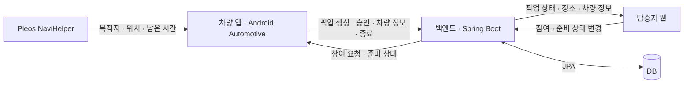
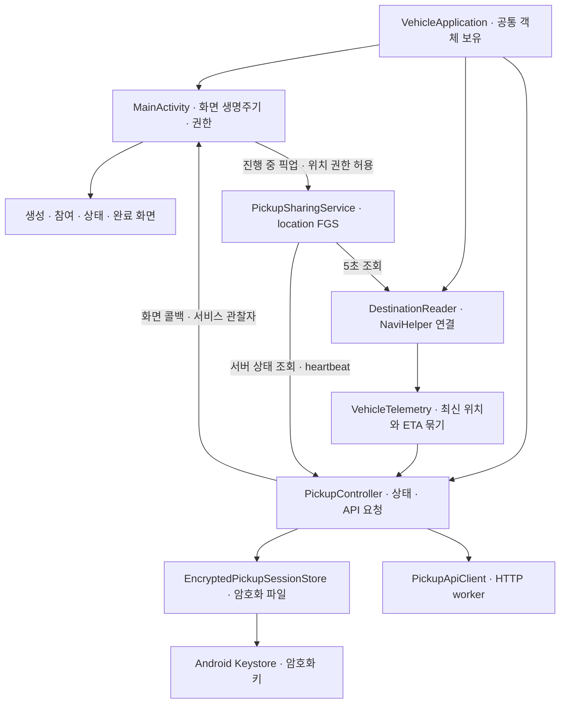
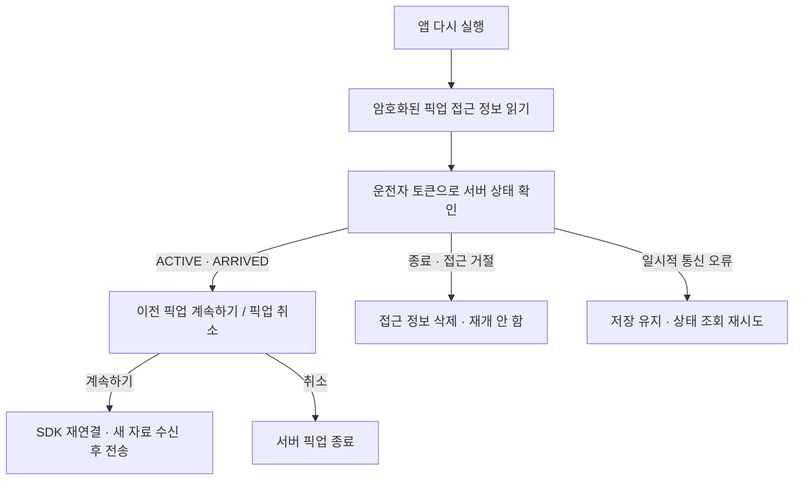
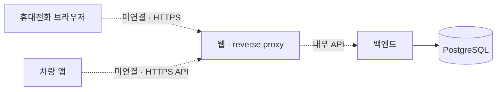

# 마중 아키텍처

2026-10-23 기준. 차량 앱 PR #7까지 반영한 구조다. 서버·웹은 분리 저장소의 기본 구현을 기준으로 적었다.

## 서비스 구성



차량과 웹은 API를 거쳐 상태를 주고받는다. WebSocket·SSE·Redis는 사용하지 않는다.
위치와 ETA는 차량 SDK에서 받고 서버는 권한·순번·유효 시간을 검사해 저장한다. 서버가 경로나 ETA를 다시 계산하지는 않는다.

현재 참여는 이름 입력 후 운전자 승인을 받는 방식이다. QR 공유·자동 연결·지도는 후속 작업이다.
운전자 휴대전화의 공유 화면도 웹으로 만들 계획이며, 별도 탑승자 앱은 아직 개발하지 않는다.

## 차량 앱 내부



### 화면을 내렸을 때

`MainActivity`는 화면 갱신을 멈춘다. `PickupSharingService`가 실행 중이면 SDK 연결은 유지한다.
서비스가 서버 상태를 약 3초마다 확인하고, SDK에는 약 5초마다 위치·목적지를 요청한다.
`ACTIVE`·`ARRIVED`에서만 실행하며 탑승 완료·취소·만료를 확인하면 연결과 알림을 정리한다.

`VehicleTelemetry`는 위치와 ETA가 모두 수신 후 10초 미만이고, ETA의 목적지가 확정 장소와 일치할 때만 한 쌍으로 꺼낸다.
컨트롤러는 최소 5초 간격으로 보낸다. 정차해 값이 같아도 전송하지만, 오래된 자료의 시각을 현재 시각으로 바꾸지는 않는다.
이전 요청이 끝나기 전에는 다음 요청을 겹쳐 보내지 않는다.

### 앱 프로세스가 종료됐을 때



저장하는 값은 픽업 ID·운전자 토큰·유효한 초대 토큰·마지막 전송 순번이다. 위치·ETA는 파일에 저장하지 않는다.
AES-GCM으로 암호화해 백업 제외 경로에 쓰고 키는 Android Keystore에서 관리한다. 다음 순번은 HTTP 요청 전에 저장한다.
재실행 복구와 시동 OFF 감지는 별개다. 강제 중지 후 자동 실행하거나 경로 안내를 자동 재시작하지 않는다.

### 주요 파일

경로는 [majung-vehicle-app](https://github.com/majung-team/majung-vehicle-app)의 `vehicle/src/main/java/app/majung/vehicle/` 기준이다.

| 파일 | 역할 |
| --- | --- |
| `VehicleApplication.kt` | reader·controller 생성, 암호화 저장소 연결과 최초 복구 |
| `MainActivity.kt` | 화면 생명주기, 권한 요청, 서비스 시작과 복구 확인 |
| `PickupCreationSection.kt` / `PickupParticipantSection.kt` | 생성·초대·참여 승인 |
| `PickupStatusSection.kt` / `PickupCompletionSection.kt` | 상태 표시·도착·완료·취소 |
| `PickupSharingService.kt` | 화면 밖 SDK 조회·전송·종료 감지 |
| `DestinationReader.kt` | SDK 연결·이벤트·조회와 연결 세대 검사 |
| `VehicleTelemetry.kt` | 위치·ETA 수신 시각과 목적지 일치 검사 |
| `PickupController.kt` | 픽업 상태·권한·순번·전송 중복 제어 |
| `PickupApiClient.kt` | JSON·Bearer 토큰 HTTP 요청 |
| `PickupSessionStore.kt` / `EncryptedPickupSessionStore.kt` | 저장 형식·암호화·원자적 파일 교체·삭제 |

[차량 화면 구조](https://github.com/majung-team/majung-vehicle-app/blob/main/docs/vehicle-screen.md) · [저장·복구](https://github.com/majung-team/majung-vehicle-app/blob/main/docs/pickup-recovery.md) · [화면 밖 공유](https://github.com/majung-team/majung-vehicle-app/blob/main/docs/background-sharing.md)

## 서버와 웹

```text
majung-backend/
  src/main/java/app/majung/server/
    MajungServerApplication.java
    pickup/
      PickupApi.java              HTTP 경로·입력·응답
      PickupService.java          권한·상태·순번·시각 검사
      Pickup.java                 픽업·참여자·최신 차량 정보
      PickupRepository.java       저장·조회·행 잠금
      TokenService.java           토큰 발급·해시 비교
      PickupRetentionJob.java     보관 기간이 지난 행 정리
  src/main/resources/             로컬·배포 설정과 초기 스키마
  deploy/                         배포 관련 파일

majung-web/
  index.html / style.css          화면·스타일
  app.js                         참여·준비 상태·주기 조회
  model.js                       화면 상태·만료 판단
  api.js                         API 요청
  dev-server.mjs                 로컬 정적 파일 제공·/api 프록시
```

Spring Boot JAR에서 웹 파일을 함께 제공하던 통합 버전과 달리, 현재 웹은 독립 저장소에서 실행한다.
로컬에서는 웹 개발 서버가 `/api` 요청을 백엔드로 넘긴다. 웹의 세션 정보는 탭의 `sessionStorage`에 보관한다.

서버는 픽업별 운전자·초대·탑승자 토큰을 구분하고 토큰 원문 대신 해시를 저장한다.
같은 픽업의 변경은 트랜잭션·행 잠금으로 처리하고 `sequence`로 중복·역순 변경을 막는다.
준비 완료, 차량 도착, 실제 탑승 완료는 각각 다른 상태다. 준비가 끝났다고 자동으로 도착 처리하지 않는다.

현재 서버 기본값은 초대 15분·픽업 2시간·차량 정보 유효 시간 30초다.
서버는 SDK 수신 시각과 서버 수신 시각에서 계산한 만료 중 이른 시점을 적용한다. 만료된 위치·ETA는 응답에서 숨긴다.
팀 명세의 무활동 자동 종료·7일 보관·마지막 값 흐림 표시는 후속 변경이며 현재 동작으로 소개하지 않는다.

## 로컬 실행과 배포 준비

| 환경 | 현재 구성 |
| --- | --- |
| 로컬 웹 | 별도 Node 개발 서버 → `/api` 프록시 → 로컬 API |
| 로컬 차량 | 공식 Pleos 에뮬레이터 → 호스트 API |
| 로컬 DB | H2 파일 DB |
| 별도 서버 | 전용 VM·PostgreSQL·프로세스 재시작·백업 복구 시험 완료 |
| 외부 접속 | 도메인·HTTPS·실제 휴대전화 연결 미완료 |

별도 VM 시험 구성에는 저장소에 아직 반영하지 않은 파일도 있다. 준비된 VM과 분리 저장소 main의 배포 완성을 같은 상태로 보지 않는다.
공개할 때는 HTTPS로 웹과 API를 연결해야 한다. 아래는 현재 배포가 아니라 남은 연결 구성이다.



## 현재 검증과 남은 범위

- 공식 에뮬레이터·로컬 API에서 생성부터 탑승 완료까지 확인했다.
- 화면을 멈춘 뒤 310초 동안 최신 차량 정보 유지, 서버 취소 후 서비스 중단을 확인했다.
- 강제 중지 전·후 복구, 재개 확인 전 미전송, 재개 후 순번 유지와 종료 후 삭제를 확인했다.
- 실차 주행·시동 OFF/ON·플랫폼 심사·공개 HTTPS·실제 휴대전화 시험은 남아 있다.

[분리 전 아키텍처](archive/integrated-architecture.md)는 이전 폴더·실행 구조를 확인하는 기록이다.
