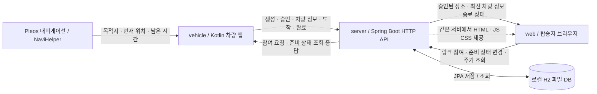
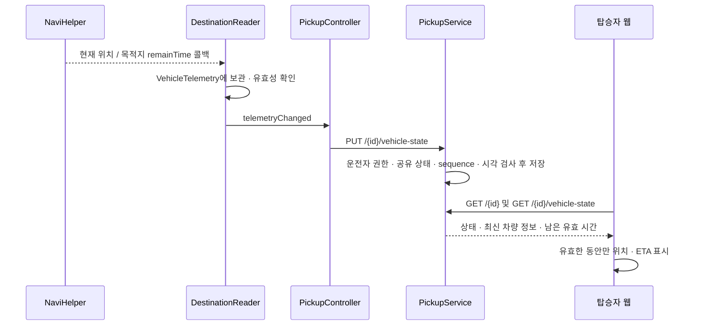

# 분리 전 통합 버전 아키텍처

저장소 분리 전 구조를 보존한 문서다. 최신 구조는 [현재 아키텍처](../architecture.md)를 본다.

# 프로젝트 작동 원리와 코드 구조

처음 코드를 보는 사람을 위한 안내다. 현재 로컬에서 실행하는 차량 앱·서버·탑승자 웹을 기준으로 설명한다.
기획 초안의 지도·장소 변경·휴대전화 페어링은 아직 이 구조에 들어 있지 않다.

## 1. 전체 구성

마중은 **차량 앱이 내비게이션 정보를 서버에 보내고, 탑승자 웹이 서버에서 그 정보를 조회하는 구조**다.
탑승자가 준비 상태를 바꾸면 반대 방향으로 서버를 거쳐 차량에 전달된다. 차량과 웹이 직접 연결되는 것은 아니다.



| 구성 | 맡는 일 | 맡지 않는 일 |
| --- | --- | --- |
| 차량 앱 | 선택 목적지 확인, 픽업 생성·승인, SDK 정보 전송, 도착·탑승 확인 | 탑승자 위치 수집, 지도 계산, 계정 본인 인증 |
| 서버 | 권한·상태·순서·만료 검사와 저장, 두 화면에 조회 결과 반환 | GPS 수집, 경로·ETA 계산, 자동 도착 판단 |
| 탑승자 웹 | 이름으로 참여, 승인 후 정보 조회, 준비 상태 변경 | 위도·경도 입력, 차량 SDK 직접 호출 |

현재는 차량 1대·픽업 1건·탑승자 1명을 다룬다. 웹의 ‘운전자 확인 화면’은 차량 없이 API를 확인하는 개발용 도구다.
그 화면에 좌표 입력이 있더라도 탑승자에게 좌표를 요구하는 흐름은 아니다.

## 2. 픽업 한 건이 처리되는 순서

### 생성 → 참여 → 승인

1. 운전자가 내비게이션에서 목적지를 선택한다. `DestinationReader`가 SDK 응답을 받고 `DestinationSelection`이 이름·좌표·수신 유효 시간을 확인한다.
2. 차량의 생성 버튼이 `PickupController.create()`를 호출한다. `PickupApiClient`가 장소를 `POST /api/v1/pickups`로 보낸다.
3. 서버의 `PickupApi` → `PickupService.createPickup()` → `PickupRepository` 순서로 저장한다. 응답에는 픽업 ID·운전자 토큰·초대 토큰이 들어간다.
4. 초대 링크를 연 웹이 URL fragment의 초대를 읽고 주소에서 지운다. 탑승자가 이름을 입력하면 `POST /{id}/participants`로 참여한다.
5. 서버는 초대 토큰을 소비하고 탑승자 전용 토큰을 발급한다. 상태는 `WAITING_APPROVAL`이며 아직 탑승자에게 장소·차량 위치를 공개하지 않는다.
6. 차량이 다음 조회에서 참여자를 확인한다. 운전자가 확인 창에서 승인하면 `POST /{id}/participants/{participantId}/approval`로 `ACTIVE` 상태가 된다.

차량은 위치와 ETA를 각각 SDK에서 받은 뒤 묶어서 전송한다. 둘 중 하나가 없거나 오래됐으면 공유할 값으로 취급하지 않는다.

### 차량 정보는 차량 → 서버 → 웹



위 그림의 API 경로 앞에는 `/api/v1/pickups`가 붙는다. `remainTime`을 초 단위 `durationSeconds`로 전달하며
서버가 경로를 다시 계산하지 않는다. `sourceTime`은 **SDK 콜백을 앱이 받은 시각**이다. GPS 측정 시각을 뜻하지 않는다.

### 준비 상태는 웹 → 서버 → 차량

탑승자가 ‘준비 완료’를 누르면 `web/app.js`의 `sendReadiness()`가 `PUT /{id}/readiness`를 보낸다.
서버가 탑승자 권한과 요청 순서를 검사하고 저장하면, 차량의 다음 `refresh()` 응답에 준비 상태가 담긴다.
준비 상태는 픽업 진행 상태와 별개다. 준비가 끝났다고 차량 도착이나 탑승 완료로 바뀌지는 않는다.

### 도착 → 탑승 완료

도착 버튼은 운전자 확인 후 `POST /{id}/arrival`을 호출한다. 상태가 `ARRIVED`로 바뀌지만 위치 공유는 유지한다.
실제 탑승을 확인하고 완료하면 `POST /{id}/completion`이 공유를 끝낸다. 자동 도착 감지로 완료하는 방식은 아니다.

서버는 완료 시 최신 차량 값을 비우고 장소를 응답에서 숨긴다. 이후 차량 정보 조회·갱신과 준비 상태 변경은 거절한다.
종료 안내용 픽업 조회는 남겨 두므로 기존 토큰으로도 종료 상태를 확인할 수 있다. 차량 앱과 웹은 종료 응답을 받은 뒤 각자의 접근 정보를 지운다.

## 3. 상태·갱신·연결 끊김

```text
INVITING → WAITING_APPROVAL → ACTIVE → ARRIVED → COMPLETED
열려 있는 픽업은 취소 가능 → CANCELLED
픽업 만료 시 조회 결과 → EXPIRED
참여·승인 전 초대 만료 시 조회 결과 → INVITE_EXPIRED

탑승자 준비 상태: WAITING / PREPARING / READY
차량 정보 응답: WAITING / FRESH / STALE
```

`EXPIRED`·`INVITE_EXPIRED`는 조회 시 현재 시각으로 계산한 응답 상태다. DB의 `Pickup.Status` enum에 저장하는 값과 구분한다.
기본 초대 유효 시간은 15분, 픽업은 2시간이다.

| 처리 위치 | 현재 기준 | 관련 코드 |
| --- | --- | --- |
| 차량 화면 | 1초마다 상태 확인·렌더 호출. 문구가 같으면 TextView를 다시 쓰지 않음 | `MainActivity.tick`, `updateText` |
| 차량의 픽업 조회 | 화면 활성 중 약 3초마다 조회. 처리 중 요청은 중복 실행하지 않음 | `MainActivity.tick`, `PickupController.refresh` |
| 차량의 SDK 재조회 | 공유 중 약 5초마다 현재 위치·목적지 조회 | `DestinationReader.pollTelemetry` |
| SDK 값 묶기 | 위치·ETA 각각 수신 후 10초 미만이며 ETA 목적지 좌표가 픽업 장소와 일치해야 함 | `VehicleTelemetry.current` |
| 차량 정보 전송 | 새 revision이 있을 때 PUT, 최소 3초 간격. 무효화 DELETE 재시도도 최소 3초 간격 | `PickupController.syncVehicle` |
| 서버 차량 값 | sourceTime·receivedAt 기준 만료 중 이른 시점 적용. 기본 30초 | `PickupService.toVehicleResponse` |
| 웹 조회 | 보이는 탭에서 약 3초마다 조회. 응답 전 재조회·변경 중 중복 조회 방지 | `web/app.js`의 `refresh` |
| 웹 만료 확인 | 250ms마다 표시 유효성 확인. 유효 시간이 끝나면 다음 서버 응답을 기다리지 않고 숨김 | `web/model.js`, `web/app.js` |

주기는 타이머 설정값이며 네트워크·앱 처리 시간 때문에 정확한 전달 시간을 보장하지 않는다.
초 단위 화면 확인이 곧 서버에 매초 전송한다는 뜻도 아니다.

SDK 해제·경로 취소·목적지 변경 때 차량은 이전 값을 무효화하고 서버에 DELETE를 보낸다.
화면을 떠나면 `MainActivity.onStop()`이 SDK를 해제한다. 서버에 무효화를 전달하지 못하면 서버의 유효 시간으로 오래된 값이 숨겨진다.
웹도 오프라인·조회 실패·탭 전환 시 표시 값을 버리고 복귀 후 다시 조회한다.
차량의 `generation`, 웹의 `epoch` 검사와 서버의 `sequence` 검사는 늦은 응답이 새 상태를 덮는 문제를 서로 다른 단계에서 막는다.

## 4. 폴더 구조와 빌드 관계

```text
majung/
├── settings.gradle.kts        # Android :vehicle, :probe 모듈 등록
├── build.gradle.kts           # Android 공통 플러그인
├── gradlew / gradle/          # Gradle Wrapper
├── vehicle/                  # 실제 차량 앱
│   └── src/
│       ├── main/java/app/majung/vehicle/
│       ├── test/             # SDK 데이터 유효성 단위 시험
│       └── androidTest/      # 에뮬레이터 SDK·로컬 API 통합 시험
├── server/                   # 별도 Gradle 프로젝트, Spring Boot 서버
│   ├── settings.gradle.kts / build.gradle.kts
│   └── src/
│       ├── main/java/app/majung/server/pickup/
│       ├── main/resources/application.properties
│       └── test/             # 실제 HTTP API 시험
├── web/                      # API와 연결한 HTML·CSS·JavaScript
├── probe/                    # SDK 수신을 확인하는 별도 Android 앱
├── design/prototype/         # 예시 데이터로만 동작하는 초기 화면
├── tools/                    # 로컬 검증·로그 집계 도구
├── docs/                     # 실행 안내·설계·검증 기록
│   ├── media/                # 공개 가능한 시연 자료
│   └── wiki/README.md        # 개발 문서 목차
├── evidence/private/         # 원본 로그 등 로컬 자료, Git 제외
├── package.json              # 커밋 검사·웹 모델 시험용 Node 설정
└── CONTRIBUTING.md           # 이슈·브랜치·커밋·PR 규칙
```

**루트 Gradle은 Android 모듈 둘만 포함한다.** 서버는 `./gradlew -p server bootRun`으로 별도 실행한다.
`server/build.gradle.kts`의 `processResources`가 `web/` 파일을 서버의 `static/`에 복사한다.
웹과 API는 같은 출처를 사용하며 React·별도 프런트 서버는 없다. 웹 파일 변경 후에는 리소스 처리가 다시 실행되도록
서버를 재실행하거나 다시 빌드해야 한다. 실행 중인 JAR가 원본 웹 폴더를 실시간으로 읽는 구조는 아니다.

차량 debug 빌드는 에뮬레이터에서 호스트를 가리키는 `http://10.0.2.2:8080`을 사용한다.
Mac 브라우저는 `http://127.0.0.1:8080`으로 접속한다. 두 주소는 같은 로컬 서버를 보는 용도다.
release 빌드의 API 주소는 아직 비어 있다. 외부 배포 서버가 설정된 것으로 보면 안 된다.

## 5. 주요 파일은 어디서 읽나

### 차량 앱 — `vehicle/src/main/java/app/majung/vehicle/`

| 파일 | 역할 |
| --- | --- |
| [VehicleApplication.kt](../../vehicle/src/main/java/app/majung/vehicle/VehicleApplication.kt) | 앱이 유지할 `DestinationReader`·`PickupController`를 만들고 SDK 변경 콜백 연결 |
| [MainActivity.kt](../../vehicle/src/main/java/app/majung/vehicle/MainActivity.kt) | Android View 코드로 개발 화면 구성, 버튼·확인 창·주기 조회·화면 생명주기 처리 |
| [DestinationReader.kt](../../vehicle/src/main/java/app/majung/vehicle/DestinationReader.kt) | NaviHelper 연결·리스너·조회·해제, SDK 이벤트를 앱 데이터로 전달 |
| [DestinationSelection.kt](../../vehicle/src/main/java/app/majung/vehicle/DestinationSelection.kt) | 픽업 생성에 사용할 목적지 검증과 30초 유효 시간 |
| [VehicleTelemetry.kt](../../vehicle/src/main/java/app/majung/vehicle/VehicleTelemetry.kt) | 현재 위치·ETA를 짝지어 신선도·픽업 목적지 일치 확인 |
| [PickupController.kt](../../vehicle/src/main/java/app/majung/vehicle/PickupController.kt) | 픽업 상태·토큰 보관, 생성·승인·조회·종료, 차량 정보 전송 순서 관리 |
| [PickupApiClient.kt](../../vehicle/src/main/java/app/majung/vehicle/PickupApiClient.kt) | HttpURLConnection으로 JSON·Bearer 토큰 요청, 오류 상태 처리 |

HTTP는 `PickupController`의 단일 worker에서 실행하고 결과를 메인 스레드로 돌려준다.
`MainActivity`에서 네트워크를 직접 호출하거나 SDK 콜백마다 화면 전체를 새로 만들지 않는다.

### 서버 — `server/src/main/java/app/majung/server/`

| 파일 | 역할 |
| --- | --- |
| [MajungServerApplication.java](../../server/src/main/java/app/majung/server/MajungServerApplication.java) | Spring Boot 시작과 UTC Clock 제공 |
| [pickup/PickupApi.java](../../server/src/main/java/app/majung/server/pickup/PickupApi.java) | HTTP 경로, 입력 검증, 요청·응답 record 정의 |
| [pickup/PickupService.java](../../server/src/main/java/app/majung/server/pickup/PickupService.java) | 역할별 권한, 상태 전이, 만료·중복·역순 검사와 응답 변환 |
| [pickup/Pickup.java](../../server/src/main/java/app/majung/server/pickup/Pickup.java) | 장소·참여자·준비·최신 차량 정보·토큰 해시를 보관하는 JPA 엔티티 |
| [pickup/PickupRepository.java](../../server/src/main/java/app/majung/server/pickup/PickupRepository.java) | 저장·조회, 픽업 한 행의 비관적 쓰기 잠금 |
| [pickup/TokenService.java](../../server/src/main/java/app/majung/server/pickup/TokenService.java) | 무작위 토큰 발급, SHA-256 해시 비교, Bearer 헤더 해석 |
| [pickup/RequestSafetyFilter.java](../../server/src/main/java/app/majung/server/pickup/RequestSafetyFilter.java) | 요청 ID와 캐시·리퍼러·CSP 등 응답 헤더 |
| [pickup/ApiException.java](../../server/src/main/java/app/majung/server/pickup/ApiException.java), [ApiErrorHandler.java](../../server/src/main/java/app/majung/server/pickup/ApiErrorHandler.java) | 오류를 code·message·requestId 형식으로 반환 |
| [application.properties](../../server/src/main/resources/application.properties) | 로컬 바인딩, H2 연결, 초대·픽업·차량 값 유효 시간 |

배포 준비 코드도 같은 pickup 패키지에 있다. `DeploymentPolicy`는 생성 키와 시작 설정, `ClientConfigurationApi`는 개발 도구 허용 여부,
`ApiRateLimitFilter`는 실제 접속 IP별 요청 제한, `PickupRetentionJob`은 보관 기간이 지난 행의 삭제를 맡는다.

작은 첫 버전이라 참여자와 최신 차량 값을 별도 테이블로 나누지 않고 픽업 한 행에 묶었다.
`PickupService`의 트랜잭션과 `findLockedById()`의 행 잠금으로 같은 픽업 변경을 직렬화한다.
`@Version`도 있지만 Redis 분산 락을 사용하는 구조는 아니다. 여러 서버·다중 탑승자 확장은 별도 검증이 필요하다.

### 웹·진단 앱·검증 도구

| 파일·폴더 | 역할 |
| --- | --- |
| [web/index.html](../../web/index.html), [style.css](../../web/style.css) | 웹 진입점·공통 화면 스타일 |
| [web/app.js](../../web/app.js) | 초대 해석, 화면·이벤트, 세션, 조회·변경 요청, 종료 처리 |
| [web/api.js](../../web/api.js) | 같은 출처 API 호출과 오류 처리 |
| [web/model.js](../../web/model.js) | 초대·세션 검증, 요청 sequence와 차량 표시 유효 시간 등 순수 함수 |
| [web/model.test.js](../../web/model.test.js) | 위 순수 함수의 단위 시험 |
| [probe/src/main/java/app/majung/probe/](../../probe/src/main/java/app/majung/probe) | `NaviProbe`가 실제 SDK 콜백을 로컬 JSONL로 기록. MainActivity는 진단 UI, ProbeApplication은 인스턴스 관리. 서버로 보내지 않는 별도 앱 |
| [design/prototype/](../../design/prototype) | 초기 화면·상태 모델 시연. 서버·SDK 실제 연동 근거로 사용하지 않음 |
| [tools/smoke_pickup_server.py](../../tools/smoke_pickup_server.py) | 실행 중인 로컬 API 기본 흐름 검증 |
| [tools/check_server_restart.py](../../tools/check_server_restart.py) | 격리한 임시 DB·서버 프로세스로 재시작 후 저장 유지 검증 |
| [tools/summarize_events.py](../../tools/summarize_events.py) | SDK 진단 JSONL의 이벤트 횟수 집계 |

## 6. 데이터와 접근 정보는 어디에 남나

| 위치 | 보관 내용과 수명 |
| --- | --- |
| 차량 앱 메모리 | 현재 픽업과 운전자·초대 토큰. 앱 프로세스 종료 후 자동 복원하지 않음. 완료 응답 시 정리 |
| 웹 sessionStorage | 해당 탭의 픽업 역할·토큰. 새로고침 시 복원하고 종료 확인 시 삭제. 브라우저 정책에 따른 제약은 별도 |
| 서버 H2 파일 | 픽업 행, 장소·참여자 이름, 토큰 해시, 최신 차량 값. 기본 URL은 `jdbc:h2:file:./data/majung`이며 상대 경로는 서버 프로세스 작업 디렉터리 기준 |
| SDK 진단 앱 내부 파일 | 수신 이벤트 원본. 실제 위치가 포함될 수 있어 추출본은 `evidence/private/`에만 보관 |

운전자·참여자 토큰은 계정 로그인용 JWT가 아니라 픽업별 무작위 Bearer 토큰이다.
초대는 참여에만 쓰며, 참여 뒤 발급된 탑승자 토큰도 운전자 승인 전에는 위치 조회에 사용할 수 없다.
DB에는 토큰 원문 대신 해시를 저장한다. 이 방식만으로 차량·사람의 신원이 검증되는 것은 아니다.

**공유 종료와 DB 행 삭제는 다르다.** 완료·취소 시 최신 차량 값과 초대 해시는 지우고 장소는 응답에서 숨기지만,
로컬 기본 실행은 행을 계속 보관한다. deploy 프로필은 종료·만료 후 기본 24시간이 지난 행 전체를 5분마다 정리한다.
보관 기간은 초기 시험 기준이며 백업 보관은 별도다. 생성 키·요청 제한과 PostgreSQL 배포 설정도 [서버 배포 준비](../server-deployment.md)에 정리했다.
GCP·HTTPS·계정/차량 인증·실제 운영 DB·백그라운드 공유까지 검증된 배포 상태는 아니다.

## 7. 읽는 순서와 수정할 위치

처음에는 [README 실행 안내](../../README.md) → 이 문서의 전체 흐름 → `MainActivity`의 버튼 →
`PickupController` → `PickupApi`·`PickupService` → `web/app.js` 순서로 한 건을 따라가면 된다.

| 바꾸려는 내용 | 먼저 볼 곳 | 확인할 시험 |
| --- | --- | --- |
| 차량 문구·버튼·도착 확인 | `MainActivity`·`PickupController` | `vehicle/src/androidTest/.../VehiclePickupTest.kt` |
| SDK 수신·연결 해제·오래된 값 | `DestinationReader`·`VehicleTelemetry` | `vehicle/src/test/.../VehicleTelemetryTest.kt` 및 에뮬레이터 시험 |
| API 필드·상태·권한 | `PickupApi`·`PickupService`·`Pickup` | `server/src/test/.../PickupApiTest.java`, 차량·웹 호출부도 대조 |
| 웹 참여·준비·끊김 화면 | `web/app.js`·`model.js`·`style.css` | `web/model.test.js`와 실제 브라우저 |

정확한 HTTP 요청·응답은 [서버 API](../server-api.md), SDK 조건·시험 결과는 [차량 정보 연동](../vehicle-telemetry.md),
웹 동작은 [탑승자 웹](../web-integration.md), 도착·종료 확인은 [차량 도착·탑승 완료](../vehicle-completion.md)를 참고한다.
