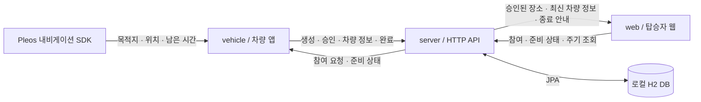
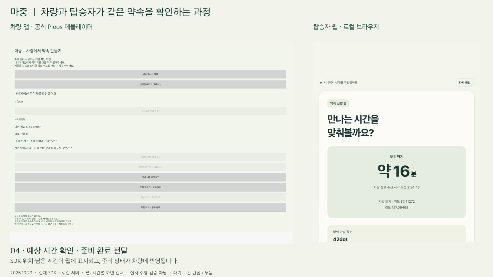
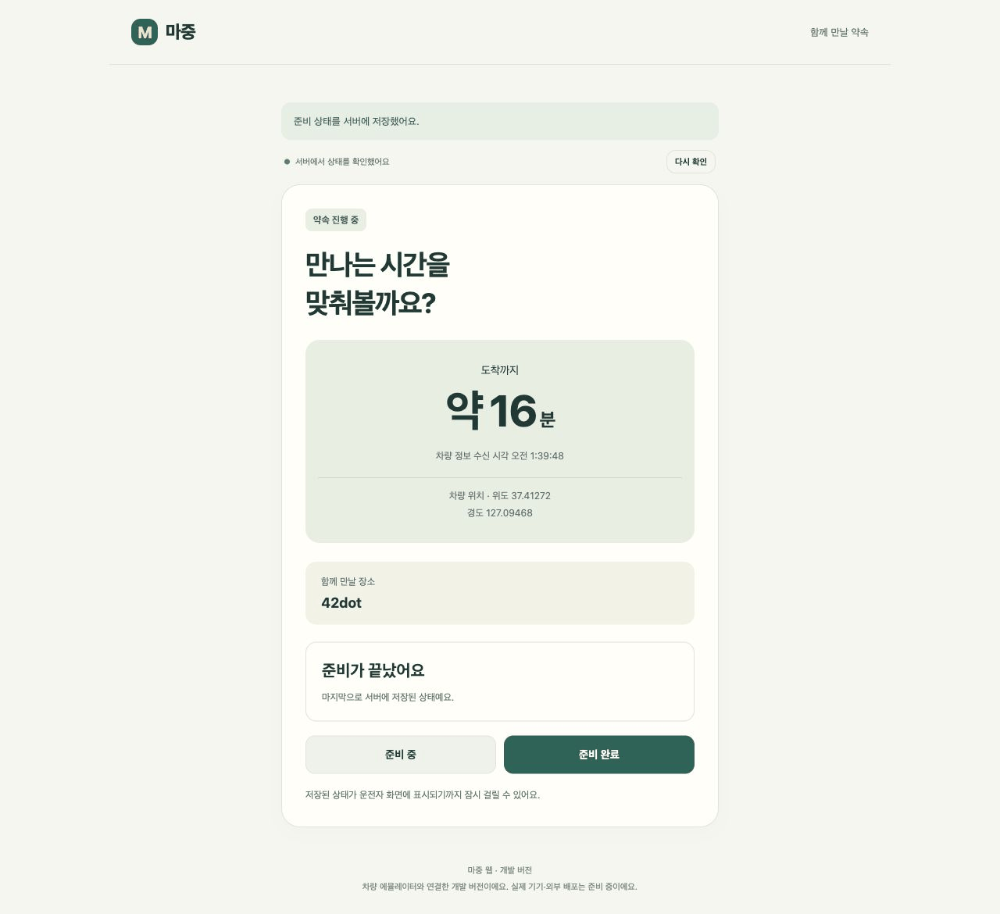
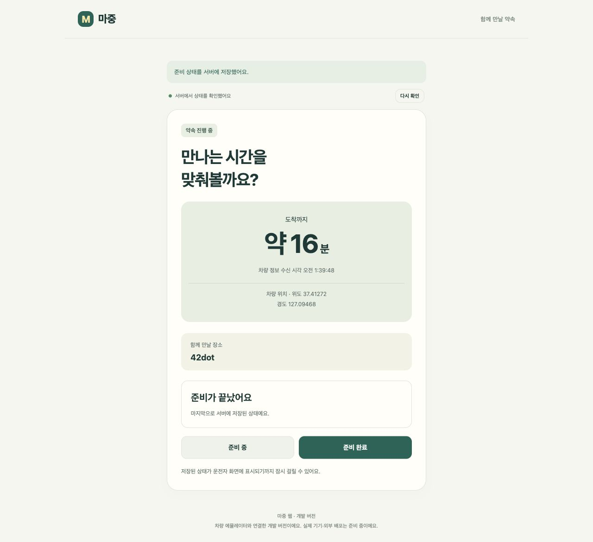
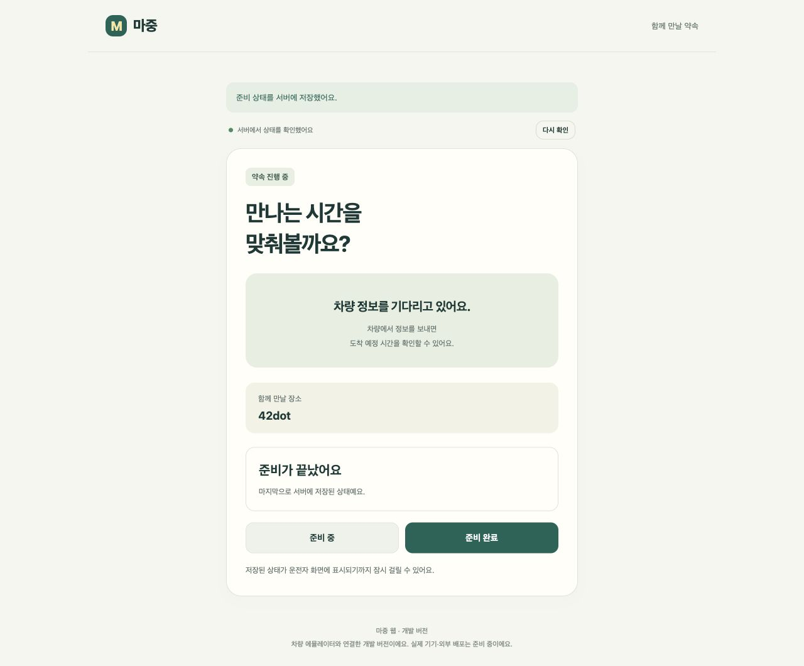

# 분리 전 통합 버전 실행 기록

이 문서는 저장소를 나누기 전 README를 보존한 기록이다. 아래 구현 범위·실행 경로·시험 수는 당시 통합 버전 기준이며 최신 제품 상태와 다를 수 있다.
지금 개발·실행할 코드는 [현재 저장소 안내](../../README.md#개발-저장소)를 따른다.

가족·지인을 데리러 갈 때 반복하는 “어디야?”, “지금 내려갈까?” 같은 연락을 줄이기 위한 차량용 앱이다.
운전자는 차량에서 탑승자의 준비 상태를 보고, 탑승자는 초대 링크로 약속 장소와 도착까지 남은 시간을 확인한다.

현재 **차량 앱 → 로컬 서버 → 탑승자 웹**을 연결했다. 차량 내비게이션에서 선택한 목적지로 픽업을 만들고,
운전자가 참여자를 승인하면 SDK에서 받은 위치·예상 시간을 웹에 표시한다. 탑승자는 이름으로 참여하며 좌표를 입력하지 않는다.

## 어떻게 연결되는가



차량과 웹은 서버에 저장한 픽업 상태를 약 3초마다 조회한다. 위치·남은 시간은 차량 SDK에서 받아 서버로 보내고,
탑승자의 준비 상태는 웹에서 서버로 보내 차량에 표시한다. WebSocket·SSE나 차량과 웹의 직접 연결은 사용하지 않는다.

코드는 `vehicle/` 차량 앱, `server/` API·DB, `web/` 실제 연결 웹으로 나뉜다.
`probe/`는 SDK 진단 앱, `design/prototype/`은 예시 데이터 화면으로 별도 유지한다.
**[작동 원리와 코드 구조](integrated-architecture.md)**에서 픽업 처리 순서, 폴더 트리, 주요 파일 역할, 갱신·끊김 처리와 코드를 읽는 순서를 볼 수 있다.

## 실제 연결 화면

[](../media/pickup-demo.mp4)

**[전체 흐름 시연 영상 · MP4](../media/pickup-demo.mp4)** — 생성 → 참여 → 승인 → 준비 완료 → 도착 → 탑승 완료·공유 종료.
공식 에뮬레이터의 차량 녹화와 탑승자 웹 화면을 함께 편집한 약 45초의 무음 영상이다.
실제 주행이나 외부 HTTPS·휴대전화 시험은 아니다. [촬영 범위와 재현 방법](../pickup-demo.md)을 함께 확인한다.

<details>
<summary>연결 해제 비교 GIF와 원본 캡처</summary>



공식 Pleos 에뮬레이터와 로컬 서버를 연결한 시험 화면이다. 정상 수신 시 위치·예상 시간을 표시하고,
SDK 연결을 해제하면 웹의 다음 조회에서 이전 정보를 숨긴다.
GIF는 **실제 캡처 2장을 4초 간격으로 반복**한 자료다. 연속 녹화나 실차 주행 영상은 아니다.

승인 후 SDK 위치·예상 시간 표시, 탑승자 준비 완료 저장:



SDK 연결 해제 후 이전 위치·예상 시간 숨김:



</details>

## 현재 되는 것과 남은 것

| 구분 | 현재 상태 |
| --- | --- |
| 차량 앱 | 내비게이션 목적지로 픽업 생성, 참여 승인, SDK 위치·예상 시간 전송, 준비 상태 조회, 도착·탑승 완료·취소 |
| 탑승자 웹 | 링크 참여, 승인 후 장소·차량 정보 확인, 준비 상태 변경, 공유 종료 안내 |
| 서버 | 픽업별 토큰 권한, 초대 만료·철회, 오래된 정보 숨김, 종료 후 접근 차단. 도착·완료 API도 구현 |
| 도착·탑승 완료 | 차량에서 확인 후 처리. 도착 시 공유 유지, 탑승 완료 시 공유 종료 |
| 외부 HTTPS·실제 휴대전화 | 아직 배포·시험 전 |
| 지도·장소 변경·탑승자 앱 | 후속 개발 |

현재 범위는 차량 1대·픽업 1건·탑승자 1명이다. 위치·예상 시간은 에뮬레이터 SDK 응답이며 실제 도로에서 정확도를 검증하지 않았다.
차량 앱은 주차 상태에서 연결을 시험하는 개발 화면이다. 주행 중 UI 허용 여부·실차·장시간 백그라운드 공유도 검증 전이다.

서버 시험은 기존 HTTP 14개와 배포 접근·요청 제한·보관 정리 11개를 합쳐 25개 통과다. 웹·초안 모델 13개도 통과했다.
차량은 이전 변경에서 단위 8개를 확인했으며 이번 서버 준비 변경에는 차량 코드를 수정하지 않았다.
공식 에뮬레이터 통합 시험 2개에서 SDK/API 값 일치, 해제·재연결, 준비 상태 전달, 취소와 차량 화면의 도착·탑승 완료를 확인했다.
상세 조건과 재현 방법은 [차량 정보 연동 기록](../vehicle-telemetry.md)에 있다.

## 로컬에서 실행하기

처음 참여했다면 [기여 가이드](../../CONTRIBUTING.md)에 따라 Node.js 22 이상과 커밋 훅을 준비한다.
Android·서버 빌드에는 JDK 25를 사용하며 Java 바이트코드 대상은 17이다.
Android Studio, SDK API 34, Build Tools 36.0.0과 공식 Pleos Connect 2.1.0 ARM64 에뮬레이터가 필요하다.
개인 SDK 경로는 커밋하지 않는 `local.properties`의 `sdk.dir`에 설정한다.

```sh
npm ci
./gradlew -p server bootRun
```

`http://127.0.0.1:8080/`에서 API에 연결한 웹을 연다.
차량 없이 웹 흐름만 확인하려면 ‘운전자 확인 화면’에서 픽업을 만들고 초대를 새 탭으로 연다.
실제 SDK 연결은 에뮬레이터에서 내비게이션 목적지를 선택한 뒤 [차량 앱 실행 안내](../vehicle-pickup.md)를 따른다.

현재 서버·초대 주소는 **같은 Mac에서 시험하는 로컬 설정**이다. 실제 휴대전화로 접속할 외부 주소는 아직 없다.
로컬에서는 개발용 생성 화면을 사용할 수 있다. 배포 프로필은 이 화면을 숨기고 API 생성 키·요청 제한·보관 정리를 적용한다.
이 키는 서버 관리용이며 현재 차량 앱에 넣지 않았다. 외부 차량 연동 전에는 생성 권한 발급과 HTTPS·DB·백업 설정이 필요하다.
[배포 준비와 검증 범위](../server-deployment.md)를 확인한다.

## 개발 문서

| 문서 | 내용 |
| --- | --- |
| [작동 원리와 코드 구조](integrated-architecture.md) | 전체 구성도, 정보 전달 순서, 폴더·파일 역할, 상태·저장·갱신 처리 |
| [차량 앱 실행](../vehicle-pickup.md) | APK 설치, 내비게이션 장소 조회, 픽업 생성·승인 |
| [차량 도착·탑승 완료](../vehicle-completion.md) | 확인 창, 공유 유지·종료, 전체 흐름 검증과 캡처 |
| [전체 흐름 시연](../pickup-demo.md) | 영상, 촬영 범위·한계, 다시 촬영하는 방법 |
| [SDK 위치·예상 시간 연동](../vehicle-telemetry.md) | 전송·무효화·재연결, 화면 갱신 수정, 시험 결과 |
| [탑승자 웹](../web-integration.md) | 참여·준비 상태·세션 처리, 개발용 운전자 화면 |
| [서버 API](../server-api.md) | 실행·권한·요청·응답·만료·오류 처리 |
| [서버 배포 준비](../server-deployment.md) | 생성 제한·요청 제한·데이터 정리·PostgreSQL 설정·백업 절차 |
| [전체 개발 문서](../wiki/README.md) | 기획, 예시 화면, SDK 진단 기록과 상세 설계 목차 |
| [기여 가이드](../../CONTRIBUTING.md) | 이슈·브랜치·커밋·PR 규칙 |

`vehicle/`은 차량 앱, `server/`는 Spring Boot·JPA·로컬 H2 서버, `web/`은 API와 연결한 웹이다.
`probe/`는 SDK 진단용 앱으로 따로 유지한다. `design/prototype/`은 예시 데이터만 사용하는 초기 화면이며 실제 연동 화면과 구분한다.

토큰·초대 링크 원문·개인 위치·원본 로그는 커밋하거나 시연 캡처에 넣지 않는다.
로컬 원본 근거는 Git에서 제외한 `evidence/private/`에 보관한다. SDK·에뮬레이터 바이너리도 저장소에 포함하지 않는다.

팀 기획과 진행 현황은 [마중 노션](https://app.notion.com/p/401de2e676c28037a1f0d1dbe6cf1288)에 정리한다.
다음 작업은 전용 DB·GCP 실행 환경과 차량 생성 권한 발급을 연결한 뒤 [외부 HTTPS·실제 휴대전화 검증](https://github.com/majung-team/majung/issues/7)을 진행하는 것이다.
