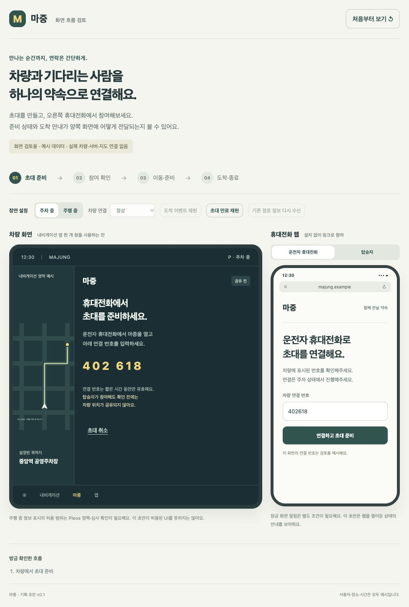
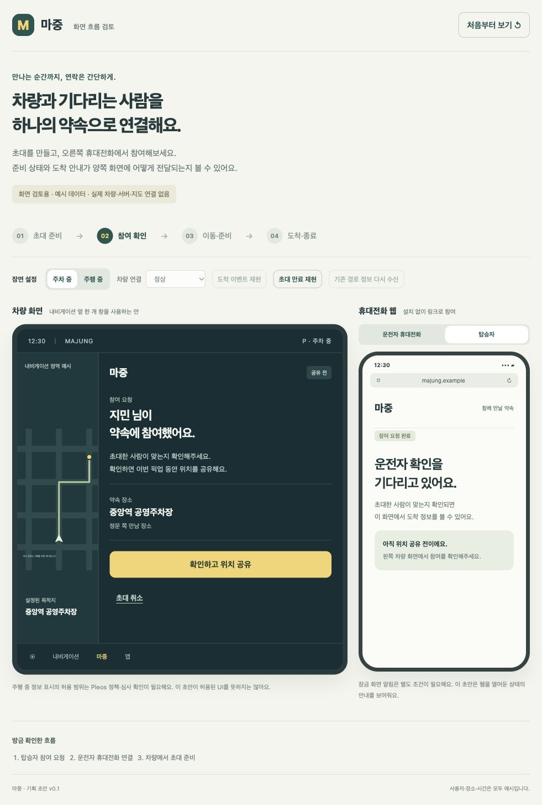
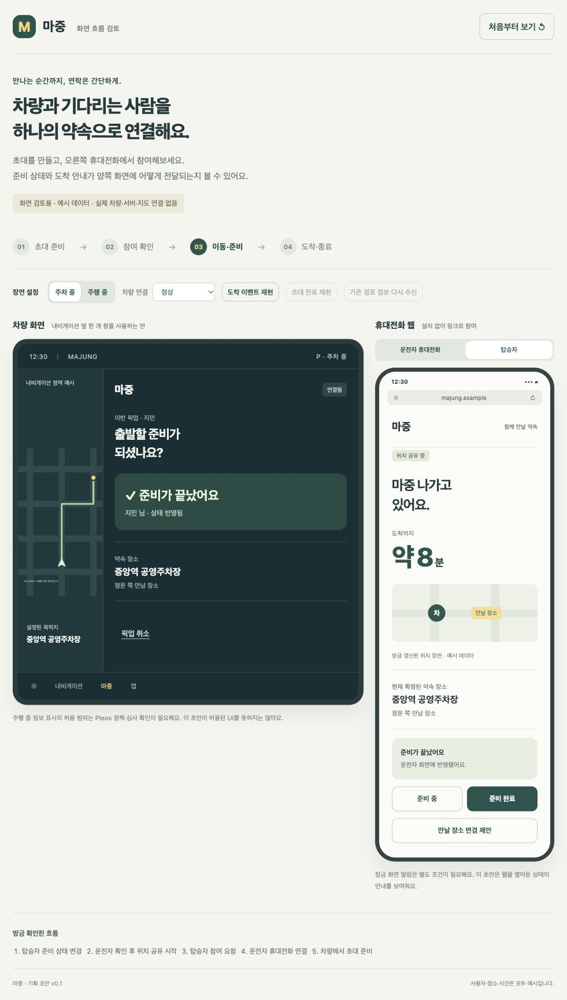
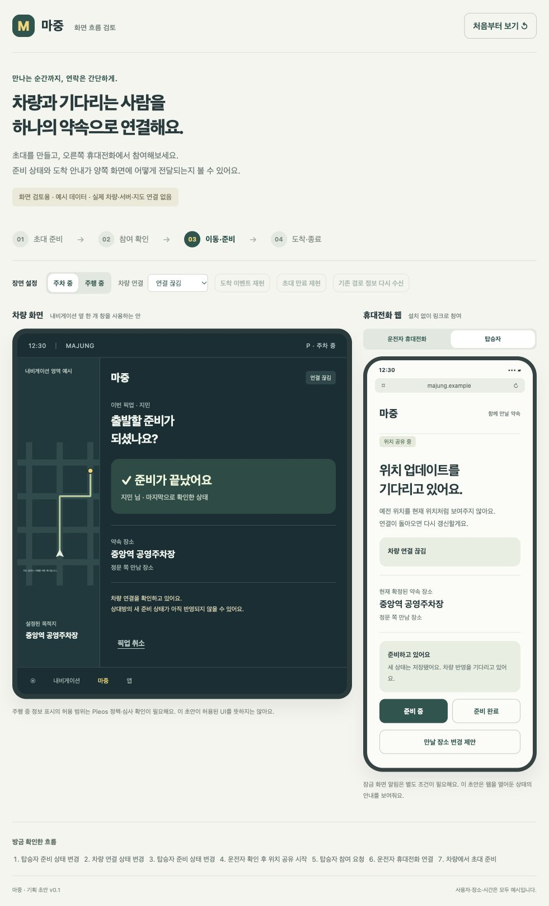
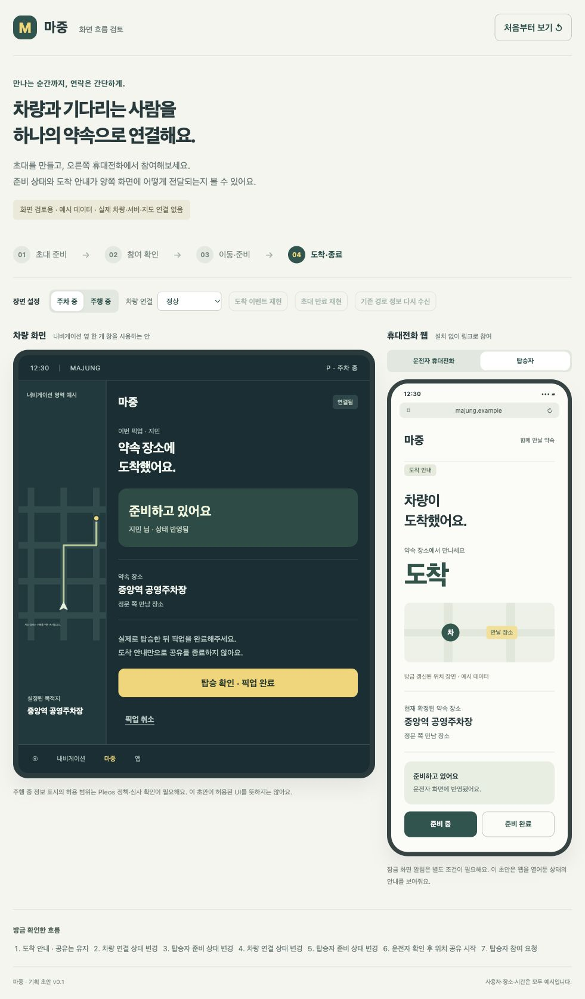
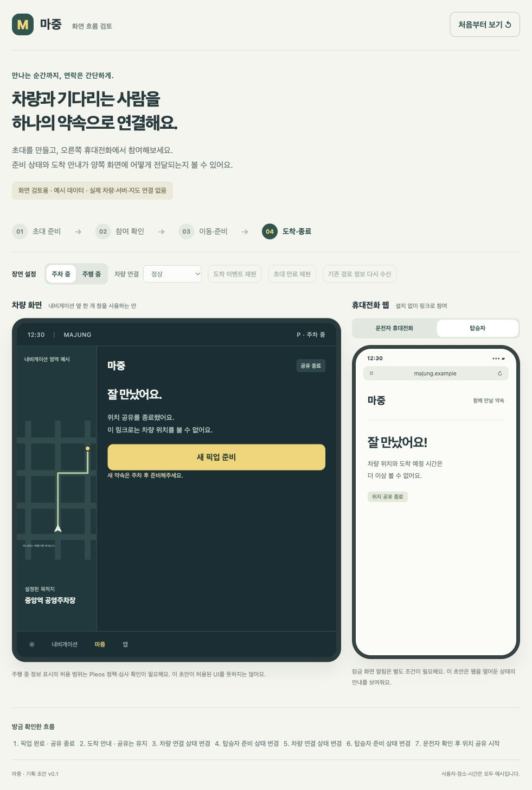
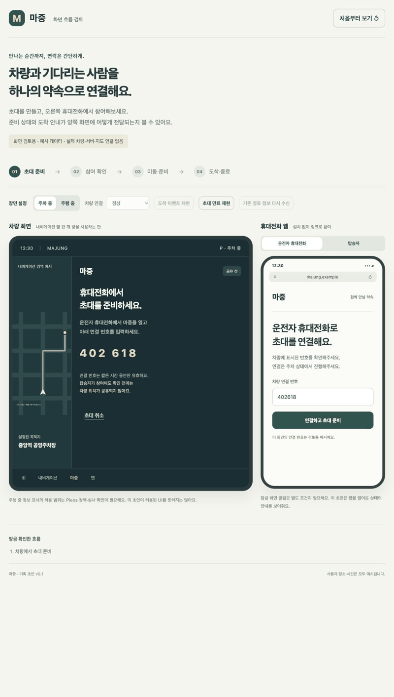

# 실행 화면과 따라 하기

2026-10-22 기준. 아래 이미지는 `design/prototype`을 브라우저에서 직접 조작하며 캡처했다.
예시 장소·인물·시간으로 동작하는 화면 초안이다. 실제 차량 SDK·지도·서버와는 연결하지 않았다.
Pleos SDK의 실행 결과는 [별도 시험 기록](sdk-verification.md)에 정리했다.

## 실행

프로젝트 루트에서 실행한다. Python 3 외에 설치할 패키지는 없다.

```sh
python3 -m http.server 4173 --bind 127.0.0.1 --directory design/prototype
```

브라우저에서 <http://127.0.0.1:4173/>을 연다. 다른 사람에게 전달해 접속시키는 공개 주소는 아니다.

## 1. 차량에서 초대 준비

차량 상태를 ‘주차 중’으로 두고 ‘초대 준비하기’를 누른다.
오른쪽 ‘운전자 휴대전화’에서 예시 연결 번호 `402618`을 입력하고 연결한다.
이 번호는 실제 인증 코드가 아니다. 링크 복사도 예시 주소만 복사한다.



## 2. 탑승자 참여와 운전자 확인

휴대전화 영역을 ‘탑승자’ 탭으로 바꾼다. 알아볼 이름을 입력하고 참여한다.
차량에서 ‘확인하고 위치 공유’를 누르기 전에는 탑승자 화면에 위치와 ETA를 표시하지 않는다.



## 3. 준비 상태 전달

차량에서 참여를 확인하고 탑승자가 ‘준비 완료’를 누른다.
차량 화면에도 준비 완료가 표시된다. 여기서 보이는 8분과 지도는 예시다.



## 4. 연결이 끊겼을 때

상단 ‘차량 연결’을 ‘연결 끊김’으로 바꾼다. 이전 위치와 ETA를 숨기는지 확인한다.
이 상태에서 탑승자가 ‘준비 중’을 누르면 차량에는 마지막 확인 상태가 남고, 휴대전화에는 반영 대기가 표시된다.
‘정상’으로 바꾸면 상태가 맞춰진다. 실제 서버에서는 저장 성공과 차량 수신 확인을 따로 처리해야 한다.



## 5. 도착과 공유 종료

‘도착 이벤트 재현’을 누른다. 도착 안내 뒤에도 공유가 유지된다.
주차 상태에서 ‘탑승 확인 · 픽업 완료’를 누르고 ‘공유 종료’를 확인하면 위치와 ETA가 사라진다.





## 더 확인할 장면

- ‘주행 중’으로 바꾸면 초대 생성·참여 승인·장소 변경·종료 조작이 제한된다. 실제 플랫폼의 UI 허용 판정은 별도 검토가 필요하다.
- 탑승자가 장소 변경을 제안하고, 차량에서 주차 상태로 요청한다. 상단에 나타나는 경로 성공·실패 버튼으로 결과를 재현할 수 있다.
- 새 경로 반영 실패 시 기존 장소가 남고 ETA는 숨겨진다. 기존 경로 정보를 다시 확인하기 전에는 과거 ETA를 복구하지 않는다.
- 초대 상태에서 ‘초대 만료 재현’을 누르면 참여할 수 없다.
- ‘처음부터 보기’로 다시 시작한다. 새로고침해도 초기화된다.

## 캡처 순서 재생



위 GIF는 캡처 6장을 순서대로 재생한다. 연속 화면 녹화나 실제 차량 주행 영상은 아니다.

## 확인 범위

브라우저 조작으로 전체 흐름과 예외 상태를 확인했고 상태 모델 테스트 8개가 통과했다.
실제 서버 권한 검사, 두 기기 사이 통신, 푸시 알림, 실차 동작을 검증한 결과는 아니다.
