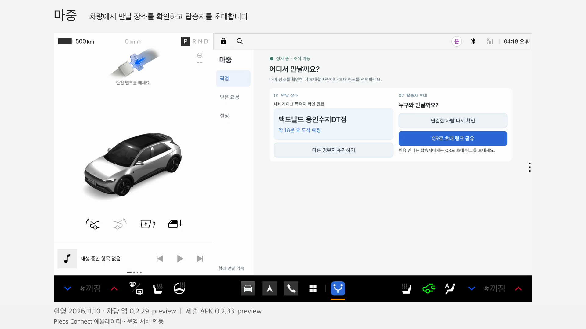

# 마중 픽업 시연 · 2026.11.10 (내비 연동판) 및 2026.10.29 기록

> [!IMPORTANT]
> **기본 내비 실행 제한 · 2026년 11월 12일 관찰**: Pleos Connect 2.1.0의 Navi42 `3.3.2-rc5-hotfix.3`이 지도 인증 응답의 `profile` 항목을 처리하지 못해 지도 초기화에 실패하는 현상을 확인했다. 마중을 실행하지 않은 콜드부팅에서도 재현됐다. 마중 APK 재설치나 NaviHelper 버전 변경으로 해결됐다고 확인한 상태는 아니며, 수정된 내비 APK·에뮬레이터 이미지와 적용 방법을 운영사무국에 문의했다. 11월 10일 정상 시연 기록과 이후 관찰한 환경 오류를 구분한다. [증상과 확인 범위](https://github.com/majung-team/majung-vehicle-app/blob/main/docs/navigation-environment.md).

마중의 초대 링크 참여부터 차량 SDK의 예상 도착 시간 공유, 탑승자 준비 상태 전달, 도착 및 탑승 완료, 그리고 차량 내비게이션 화면 위 메시지·음성 안내와 장소 제안 경유지 반영까지의 흐름을 담은 시연 기록이다.

2026년 11월 13일에는 촬영 장면과 음성을 유지한 채 버전 안내와 장소 확정 자막 시점을 보완했다. 영상 안에 촬영 APK `0.2.29-preview`와 제출 APK `0.2.33-preview`를 구분해 표시한다.

2026년 11월 10일 내비 연동판은 공식 Pleos Connect 에뮬레이터(`0.2.29-preview`)와 운영 서버(`majung.cloud`)를 연결해 촬영했으며, 2026년 10월 29일 초기 기본 흐름 기록도 아래에 함께 보존한다.

## 1. 대표 시연 영상 · 2026.11.10 (내비 연동판)

[](media/pickup-demo.mp4)

- **[MP4 파일 보기 (1분 36초 · 음성 포함)](media/pickup-demo.mp4)**

**영상 및 촬영 버전 정보**

| 항목 | 내용 |
| --- | --- |
| 촬영일 | 2026년 11월 10일 |
| 자막 보완 | 2026년 11월 13일 · 촬영/제출 버전 구분, 경로 확인 중/약속 장소 확정 자막 분리 |
| 재생 시간 | 약 1분 36초 (`96.17초`) |
| 해상도 | 1920 × 1080 |
| 영상 형식 | MP4 · H.264 · 30fps · AAC 오디오 |
| 음성 | 에뮬레이터 안내 음성(Pleos TTS) 포함 |
| 차량 환경 | 공식 Pleos Connect v2.1.0 에뮬레이터 (`Pleos_Connect_v2_0`, `2560 × 1440 px / 160 dpi`, Android 14 / API 34 · 영상 촬영 시 `0.2.29-preview`, 버전 코드 `31`, 소스 `6d599f1`) |
| 웹 환경 | 운영 서버(`https://majung.cloud`, 커밋 `30e28d2`) · 모바일 크기 브라우저 |
| 백엔드 | 운영 서버 (`3546902`, Green 슬롯) |
| 개인정보·보안 | 초대 QR 영역 마스킹(`초대 QR 가림`), 96프레임 전체 QR 바코드 0건 확인 |

> 이 영상은 공식 Pleos Connect 에뮬레이터와 운영 서버(`majung.cloud`)를 연결한 시연이다. 실제 차량 주행이나 실제 휴대전화 푸시 알림 수신을 검증한 영상은 아니다.

### 1.1 시간대별 시연 장면 (2026.11.10 내비 연동판)

| 구간 | 화면 구성 | 확인 내용 |
| --- | --- | --- |
| `00:00 ~ 00:09.5` | 차량 앱 단독 | 차량 앱(`0.2.29-preview`)에서 만날 장소(`맥도날드 용인수지DT점`) 확인 및 탑승자 초대 준비 (`초대 QR 가림` 마스킹 적용) |
| `00:09.5 ~ 00:45.0` | 차량 앱 + 탑승자 웹 | 초대 링크 참여 → 차량 위치·예상 도착 시간(`약 18분 후 도착`) 표시 → 탑승 준비 완료 선택 및 차량 반영 → 운전자 도착 알림 → 탑승 확인 후 양쪽 픽업 종료 및 위치 공유 종료 |
| `00:45.0 ~ 00:51.4` | 차량 내비 + 탑승자 웹 | 탑승자가 **‘지금 내려가요’** 퀵 메시지를 보내면 차량 내비 화면 위에 알림 카드가 뜨고 에뮬레이터 안내 음성(TTS) 출력 |
| `00:51.4 ~ 01:02.0` | 차량 내비 + 탑승자 웹 | 탑승자가 다른 장소(**광교중앙역 신분당선**)를 제안하면 내비 화면 위에 장소 변경 요청 알림이 뜨고, 운전자 수락 전까지 기존 약속 장소 유지 |
| `01:02.0 ~ 01:10.9` | 차량 내비 + 탑승자 웹 | 내비 화면 위 알림에서 **‘수락 및 내비 변경’** 선택 → 기존 최종 목적지는 유지하고 제안 장소(광교중앙역)를 경유지로 추가한 경로 열림 |
| `01:10.9 ~ 01:15.2` | 차량 내비 + 탑승자 웹 | 새 경로 확인 중 안내. 탑승자 웹에서 기존 장소·제안 확인 대기를 표시하며 실제 확정까지 구분 |
| `01:15.2 ~ 01:19.65` | 차량 내비 + 탑승자 웹 | 경로 반영 후 탑승자 웹의 약속 장소가 **광교중앙역 신분당선**으로 변경된 장면에 완료 자막 표시 |
| `01:19.6 ~ 01:29.1` | 요약 카드 1 | 구현 기능 요약 (`차량에서 직접 초대`, `탑승자가 먼저 요청·대기열`, `내비를 보는 중에도 알림`, `끊겼을 때 다시 이어가기`) |
| `01:29.1 ~ 01:36.2` | 요약 카드 2 | 주행·대기 안내 및 검증 범위 (`도착 전 웹 알림`, `주행 중 조작 제한`, `위치 공유는 픽업이 끝날 때까지` / 실제 차량 주행과 휴대전화 푸시 수신 미포함 명시) |

### 1.2 자막 보완 및 확인 · 2026.11.13

- 처음과 마지막에 촬영 `0.2.29-preview` / 제출 APK `0.2.33-preview` 표시
- `70.9~75.2초` 경로 확인 중, `75.2~79.65초` 경로·약속 장소 확정으로 자막 구분
- 촬영 장면 순서·재생 속도 유지, AAC 음성 스트림 복사 및 원본 해시 일치 확인
- 전체 영상·음성 디코딩 통과, 1초 간격 96개 프레임의 QR 검출 0건 확인
- [보완 기록](evidence/demo-polish-2026-11-13.json) · [편집 스크립트](../tools/polish_pickup_demo.py)

다시 생성할 때는 보완 전 원본이 필요하다. `31d884a` 커밋의 `docs/media/pickup-demo.mp4`가 원본이며, 스크립트가 입력 해시를 대조해 중복 편집을 막는다. Python 3·Pillow·FFmpeg와 한국어 글꼴을 사용한다.

```sh
git show 31d884a:docs/media/pickup-demo.mp4 > /tmp/majung-demo-original.mp4
python3 tools/polish_pickup_demo.py \
  --input /tmp/majung-demo-original.mp4 \
  --output /tmp/majung-demo-polished.mp4 \
  --ffmpeg /path/to/ffmpeg \
  --font /path/to/korean-font
```

### 1.3 2026.11.10 영상의 포함 범위와 미검증 항목 구분

| 항목 | 2026.11.10 영상 포함 여부 | 비고 |
| --- | --- | --- |
| 차량에서 만날 장소 확인 및 초대 화면 | 포함 | 초대 QR 영역 마스킹 처리 |
| 초대 링크 참여 및 SDK 위치·ETA 표시 | 포함 | 운영 서버(`majung.cloud`) 연동 |
| 탑승 준비 완료 상태 전달 | 포함 | 웹 저장 및 차량 앱 반영 확인 |
| 도착 알림 및 탑승 확인 후 위치 공유 종료 | 포함 | 수동 도착 확인 후 완료 처리 |
| 내비 화면 위 탑승자 메시지 알림 및 TTS 음성 | 포함 | `00:45` 구간 ‘지금 내려가요’ 알림 및 음성 녹음 |
| 탑승자 장소 제안 및 수락 전 기존 장소 유지 | 포함 | `00:51` 구간 광교중앙역 제안 |
| 내비 화면 위 ‘수락 및 내비 변경’ 경유지 반영 | 포함 | `01:02` 구간 최종 목적지 유지·경유지 추가 및 웹 장소 갱신 |
| 연결된 탑승자 직접 초대·다중 대기열·주행 제한 | 요약 안내 | 별도 에뮬레이터·통합 시험으로 검증 ([개발 현황](development-status.md)) |
| 실제 휴대전화 푸시 알림 배너 수신 | 미포함 | 실제 휴대전화 별도 검증 필요 |
| 실제 차량 주행 및 시동 OFF/ON | 미포함 | 에뮬레이터 환경 시연 |

---

## 2. 초기 기본 흐름 시연 기록 · 2026.10.29

https://github.com/user-attachments/assets/e181fcc1-599f-47e9-ac96-98135dae2f24

**영상 정보 (2026.10.29)**

| 항목 | 내용 |
| --- | --- |
| 촬영일 | 2026년 10월 29일 |
| 재생 시간 | 약 41초 |
| 해상도 | 1920 × 1080 |
| 영상 형식 | MP4 · H.264 · 24fps |
| 음성 | 없음 |
| 차량 환경 | 공식 Pleos Connect 에뮬레이터 |
| 웹 환경 | 데스크톱 브라우저의 모바일 화면 크기 설정 |
| 백엔드 | 로컬 API |
| 픽업 데이터 | 시험용 픽업 사전 생성 |

[MP4 파일](media/pickup-demo-20261029.mp4)

> 이 영상은 에뮬레이터와 로컬 API를 이용한 개발 시연이다. 실제 차량이나 실제 휴대전화의 전체 픽업 과정을 검증한 영상은 아니다.

---

## 2. 시연에서 확인한 기능

영상은 다음 순서로 진행된다.

| 순서 | 기능 | 확인 내용 |
| --- | --- | --- |
| 1 | 초대 링크 참여 | 회원가입·이름 입력·운전자 승인 없이 링크를 통한 픽업 참여 |
| 2 | 차량 SDK ETA 공유 | NaviHelper에서 수신한 예상 도착 시간을 모바일 웹에 표시 |
| 3 | 준비 상태 전달 | 웹에서 준비 완료 선택 → 차량 앱 수신 → 웹 전달 상태 갱신 |
| 4 | 차량 도착 처리 | 차량 화면에서 수동 도착 안내 |
| 5 | 탑승 완료 | 차량에서 탑승 확인 및 완료 → 웹 위치·ETA 표시 종료 |

### 초대 링크 참여

탑승자는 전달받은 링크를 열어 픽업에 참여한다.

이번 시연에서는 계정 가입, 별도 이름 입력 또는 운전자 승인 없이 참여하는 흐름을 확인했다.

픽업 자체는 로컬 API에서 사전에 생성했으므로 차량 화면에서 초대를 생성하는 과정은 포함되지 않았다.

### 차량 위치 및 ETA 공유

차량 앱에서 실제 SDK 정보를 수신하고 로컬 API를 통해 웹에 전달한다.

웹에는 해당 픽업의 예상 도착 시간이 표시된다.

ETA는 차량 SDK가 제공한 값이며, 서버에서 교통 상황을 별도로 계산하거나 영상 제작 과정에서 합성한 값이 아니다.

### 준비 상태 전달

1. 탑승자가 웹에서 **준비 완료** 선택
2. 서버에 준비 상태 반영
3. 차량 앱에서 변경된 준비 상태 수신
4. 웹에서 차량 전달 상태 갱신

차량 앱의 수신 확인은 운전자가 실제로 화면을 읽었다는 의미와 구분한다.

### 도착 및 탑승 완료

차량 앱에서 수동으로 도착 상태를 알린 뒤 탑승 완료를 처리한다.

픽업이 종료되면 웹에서 이전 차량 위치와 ETA가 더 이상 표시되지 않는지 확인한다.

이번 영상의 도착 처리는 수동 조작이며, SDK 자동 도착 이벤트를 검증한 결과는 아니다.

---

## 3. 촬영 및 검증 환경

### 차량 환경

| 항목 | 구성 |
| --- | --- |
| 플랫폼 | Pleos Connect 2.1 |
| 실행 환경 | 공식 Pleos 에뮬레이터 |
| 아키텍처 | ARM64 |
| Android API | 34 |
| 내비게이션 SDK | NaviHelper 3.0.5 |
| 에뮬레이터 사용자 | 10 |
| 앱 | 10월 29일 촬영 당시 차량 서비스 화면. 10월 30일 0.2.15의 글자·버튼 크기 변경 전 |
| 테스트 코드 | [차량 PR #81](https://github.com/majung-team/majung-vehicle-app/pull/81) |

### 서버 및 모바일 웹

| 항목 | 구성 |
| --- | --- |
| 백엔드 | 로컬 API |
| API 주소 | `http://10.0.2.2:8080` |
| 웹 개발 서버 | 포트 `4173` |
| 웹 기준 커밋 | `ed450be` |
| 서버 기준 커밋 | `f186361` |
| 웹 화면 크기 | 390 × 844 |

웹은 실제 브라우저에서 실행했지만, 화면 크기를 모바일에 맞춘 데스크톱 브라우저 환경이다.

실제 휴대전화에서 촬영한 영상은 아니다.

### 시험 데이터

픽업은 로컬 API에서 미리 생성한 시험 데이터를 사용했다.

다음 과정은 촬영 전에 준비했다.

- 차량 등록
- 운전자 로그인
- 위치 공유 안내 동의
- 시험용 픽업 생성
- 필요한 접근 권한 및 SDK 연결 준비

따라서 영상만으로 위 과정의 정상 동작을 확인했다고 판단하지 않는다.

---

## 4. 영상 촬영 및 편집 방식

차량과 웹 화면은 서로 다른 방법으로 수집했다.

**차량 화면**

Android 화면을 연속 녹화했다.

**모바일 웹 화면**

실제 브라우저에서 주요 단계별 화면 7장을 수집했다.

390px 웹 화면은 데스크톱 브라우저의 크기를 조정한 것으로, 실제 휴대전화 화면 녹화가 아니다.

### 편집 방식

- 차량 화면과 웹 화면을 호스트 시각 기준으로 정렬
- 사용자 조작 사이의 대기 구간 제거
- Android 화면 녹화와 웹 단계별 화면 결합
- 원본 SDK 응답값 유지
- 영상 재생 속도 변경 없음
- SDK 응답값 합성 없음

웹 화면 사이의 움직임은 연속 촬영되지 않았으므로 일부 구간이 정지 화면처럼 보인다.

시간이 맞춰진 화면을 결합한 영상이며, 두 기기에서 동시에 연속 녹화한 결과는 아니다.

---

## 5. 시연으로 검증하지 않은 항목

영상에서 확인한 범위와 실제 서비스의 전체 구현·검증 범위는 구분한다.

| 항목 | 영상 포함 여부 |
| --- | --- |
| 초대 링크 참여 | 포함 |
| SDK ETA 표시 | 포함 |
| 준비 상태 전달 | 포함 |
| 수동 도착 처리 | 포함 |
| 탑승 완료 후 위치·ETA 종료 | 포함 |
| 차량 최초 계정 연결 | 미포함 |
| 차량 화면에서 픽업 생성 | 미포함 |
| 연결된 탑승자 직접 초대 | 미포함 |
| 장소 변경 제안 및 확정 | 미포함 |
| 여러 탑승자 대기열 | 미포함 |
| 실제 휴대전화 GPS | 미포함 |
| 실제 휴대전화 푸시 알림 | 미포함 |
| 공개 HTTPS 전체 픽업 | 미포함 |
| 실차 주행 및 시동 OFF/ON | 미포함 |
| 주행 중 ETA 변화 | 미포함 |
| SDK 자동 도착 이벤트 | 미포함 |

에뮬레이터는 정차 상태에서 실행했다.

따라서 실제 주행 중 ETA 감소, 교통량 변화 반영, 주행 제한 및 자동 도착 판정까지 이 영상으로 검증한 것은 아니다.

해당 기능의 구현 내역과 별도 시험 결과는 [개발 현황](development-status.md)을 참고한다.

---

## 6. 시연 재현 방법

이 절은 동일한 개발 환경에서 영상을 다시 촬영하기 위한 절차다.

일반 사용자 테스트와 달리 개발용 앱, 로컬 API, 별도의 시험 AVD가 필요하다.

### 6.1 사전 준비

[로컬 실행 안내](vehicle-pickup.md)에 따라 개발 환경을 구성한다.

**필요 환경**

- Pleos Connect 공식 에뮬레이터
- 로컬 Spring Boot API
- 모바일 웹 개발 서버
- 로컬 API로 빌드한 차량 Debug 앱
- Android SDK 및 ADB
- Python 3
- FFmpeg

**사용 포트**

| 대상 | 주소 |
| --- | --- |
| 로컬 API | `http://10.0.2.2:8080` |
| 웹 개발 서버 | `4173` |

에뮬레이터의 위치 권한은 테스트 전에 허용한다.

> 녹화 테스트는 차량 앱의 기존 연결 정보에 영향을 줄 수 있다. 평소 사용하는 AVD가 아닌 별도 시험 AVD에서 진행한다.

### 6.2 테스트 실행

시험 대상 에뮬레이터와 Android 사용자 번호를 확인한다.

기록 당시 환경은 다음과 같다.

- 에뮬레이터: `emulator-5556`
- Android 사용자: `10`

다음 명령으로 계측 테스트를 실행한다.

```sh
adb -s emulator-5556 shell am instrument --user 10 -w \
  -e class app.majung.vehicle.VehicleDemoRecordingTest \
  -e recordDemo true \
  app.majung.vehicle.test/androidx.test.runner.AndroidJUnitRunner
```

기기 번호와 사용자 번호는 실제 환경에 맞게 변경한다.

### 6.3 브라우저 연결 도구 실행

다른 터미널에서 다음 명령을 실행한다.

```sh
python3 tools/bridge_demo_recording.py \
  --adb "$ANDROID_SDK_ROOT/platform-tools/adb" \
  --serial emulator-5556 \
  --user 10
```

`--serial`은 필수로 지정한다.

여러 에뮬레이터가 연결된 경우 다른 장치로 명령이 전달되지 않도록 확인한다.

### 6.4 촬영 단계 제어

시험 진행 상태는 아래 경로에 기록한다.

```text
evidence/private/demo-recording/
├── phase.txt
└── invitation.json
```

`phase.txt`는 현재 진행 단계를 관리하고, `invitation.json`은 시험용 초대 정보를 브라우저에 전달하는 데 사용한다.

초대 정보 원문은 채팅, 공개 로그, 화면 캡처에 출력하지 않는다.

**단계별 신호**

| 신호 | 동작 |
| --- | --- |
| `ready` | 시험 준비 완료 |
| `create.go` | 사전 생성한 픽업 초대 링크 전달 |
| `passenger-ready` | 탑승자 준비 완료 확인 |
| `arrive.go` | 차량 UI에서 도착 버튼 및 확인 창 조작 |
| `complete.go` | 차량 UI에서 탑승 완료 버튼 및 확인 창 조작 |
| `finish.go` | 종료 화면 수집 |
| `stop` | 연결 도구 종료 |

각 신호는 해당 경로에 빈 파일로 생성한다.

`create.go`는 사전 생성한 픽업 링크를 전달하는 동작이며, 차량 UI에서 픽업을 새로 생성하는 단계가 아니다.

사람의 조작을 기다리는 시간은 최대 180초로 설정했다.

### 6.5 Android 화면 녹화

별도 터미널에서 Android 화면을 녹화한다.

```sh
adb -s emulator-5556 shell screenrecord /sdcard/vehicle.mp4
```

녹화가 끝나면 파일을 개발 PC로 가져와 편집 입력으로 사용한다.

```sh
adb -s emulator-5556 pull /sdcard/vehicle.mp4
```

시험용 초대 정보는 영상에 포함하지 않는다.

---

## 7. 영상 편집 및 생성

### 필요한 도구

- Python 3.9 이상
- Pillow
- FFmpeg
- 한국어 표시가 가능한 폰트

### 입력 자료

| 파일 | 용도 |
| --- | --- |
| `vehicle.mp4` | 차량 화면 연속 녹화 |
| `web/` | 웹 단계별 PNG 이미지 |
| `timeline.json` | 호스트 밀리초 기준 화면 시각 |
| `device-start.txt` | 장치 녹화 시작 시각(초) |

기록 당시 기준 입력 크기:

- 차량 원본: 2560 × 1440
- 웹 화면: 390 × 844

### 편집 명령

```sh
python3 tools/render_pickup_demo.py \
  --capture-dir evidence/private/demo-recording \
  --ffmpeg /path/to/ffmpeg \
  --font /path/to/korean-font \
  --output docs/media/pickup-demo-20261029.mp4
```

FFmpeg 실행 파일 경로와 폰트 경로는 개발 환경에 맞게 지정한다.

편집 후 영상의 전체 디코딩과 주요 단계의 대표 프레임을 확인한다.

---

## 8. 테스트 및 영상 생성 결과

### 계측 테스트

| 항목 | 결과 |
| --- | --- |
| 테스트 | `VehicleDemoRecordingTest` |
| 실행 결과 | `OK (1 test)` |
| 실행 시간 | 175.659초 |

### 최종 영상

| 항목 | 결과 |
| --- | --- |
| 출력 해상도 | 1920 × 1080 |
| 비디오 코덱 | H.264 |
| 프레임률 | 24fps |
| 재생 시간 | 약 40.7초 |
| 검증 | 전체 디코딩 및 주요 단계 대표 프레임 확인 |

계측 테스트 통과는 해당 시연 시나리오의 실행 결과다.

전체 기능 테스트나 실제 휴대전화·실차 통합 테스트의 통과를 의미하지 않는다.

---

## 9. 이전 시연과 비교

[2026년 10월 23일 초기 시연](https://github.com/user-attachments/assets/3090606c-4212-4439-8da4-d6c45c02e819)

초기 영상은 당시의 이름 입력 및 승인 기반 참여 흐름을 보여준다.

2026년 10월 29일 영상은 변경된 초대 링크 참여 방식과 현재 차량 UI를 기준으로 촬영했다.

과거 영상은 당시 구현을 확인하는 기록으로 유지하며, 현재 이용 방법의 기준으로 사용하지 않는다.

---

## 10. 관련 문서

- [프로젝트 README](../README.md)
- [마중 문서 목록](README.md)
- [팀 테스트 안내](team-testing.md)
- [개발 현황과 PR 근거](development-status.md)
- [현재 아키텍처](architecture.md)
- [시연 촬영 순서](demo-script.md)
- [차량 앱 Releases](https://github.com/majung-team/majung-vehicle-app/releases)

실제 휴대전화와 공개 서버를 연결한 전체 픽업 흐름은 [팀 테스트 안내](team-testing.md)에 따라 별도로 검증한다.

---

## 기록 관리

이 문서는 2026년 10월 29일에 수행한 시연의 환경과 결과를 보존한다.

- 기존 영상과 테스트 결과 유지
- 당시 차량 SDK·서버·웹 버전 기록
- 로컬 API 기반 시연과 공개 서버 검증 구분
- 단계별 웹 이미지와 연속 차량 녹화 구분
- SDK 원본 응답과 영상 편집 결과 구분
- 실제 휴대전화 및 실차 미검증 범위 명시

새 시연을 촬영하는 경우에는 기존 결과를 덮어쓰기보다 별도 날짜와 버전을 기록한다.
