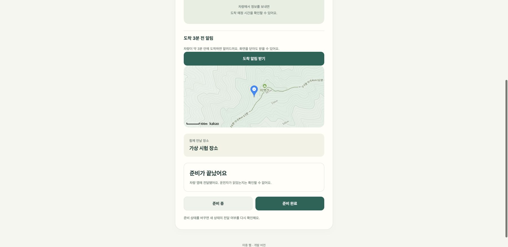

# 준비 상태 전달과 만날 장소 선택

## 준비 상태는 어디까지 전달됐는가

탑승자 준비 상태를 서버에 저장한 사실과 차량 앱이 받은 사실을 구분한다. 차량 앱은 조회한 탑승자 ID·준비 순번을 서버에 확인 전송한다. 웹은 이 값으로 전달 대기·전달 완료를 표시한다. 운전자 열람 여부는 확인하지 않는다.

준비 상태를 다시 바꾸면 새 수신 확인을 기다린다. 연결을 끊고 다른 탑승자가 참여하면 이전 사람의 지연 확인이 새 사람에게 적용되지 않는다. 종료한 픽업에는 확인을 보낼 수 없다. 이 확인으로 차량 활동 시간을 늘리지 않는다.

- [서버 PR #23](https://github.com/majung-team/majung-backend/pull/23)
- [차량 PR #34](https://github.com/majung-team/majung-vehicle-app/pull/34)
- [웹 PR #28](https://github.com/majung-team/majung-web/pull/28)

공개 서버에 가상 시험 픽업을 만들고 브라우저에서 준비 완료를 선택했다. Pleos 에뮬레이터의 새 차량 컨트롤러가 HTTPS로 조회·수신 확인을 전송한 뒤 공개 웹에 전달 완료가 표시됐다. 준비 중으로 다시 바꾸면 전달 대기로 돌아가는 것도 확인했다. 시험 픽업은 취소했고 시험 차량 권한은 회수했다.

서버 시험은 76건 중 75건 통과·기존 수동 브라우저 시험 1건 제외. 차량 JVM 42건·빌드·lint와 HTTP 실패 재확인 에뮬레이터 시험을 통과했다. 공개 서버 수신 시험도 별도로 통과했다. [식별 정보 없는 시험 기록](evidence/readiness-receipt-2026-10-26.json)을 남겼다.

## 현재 위치 말고 다른 장소에서 만나기

새 마중 요청에서 지도 핀을 선택하고 설명을 적을 수 있다. 지도를 열기만 해서는 장소가 선택되지 않는다. 현재 위치는 선택 가능한 보조 수단으로 유지한다. 직접 고른 고정 지점과 2분 뒤 만료되는 GPS 측정을 구분한다.

[웹 PR #30](https://github.com/majung-team/majung-web/pull/30) · [화면과 사용 방법](https://github.com/majung-team/majung-web/blob/main/docs/pickup-place-selection.md)

실제 카카오 SDK와 로컬 가상 계정에서 선택 전 전송 차단·핀 표시·설명 입력을 확인했다. 웹 자동 시험 36건을 통과했다. 장소 키워드 검색, 진행 중 픽업의 장소 변경, 실차 주행 검증까지 끝낸 것은 아니다.

## 장소명·주소로 찾기

장소명·주소를 적고 검색한 뒤 이름과 주소를 확인해 선택한다. 선택하면 지도 핀이 이동하고 장소 이름이 설명란에 들어간다. 정문·주차장 입구 등의 설명을 보완하고 별도 요청 버튼을 누른다. 첫 결과를 자동으로 고르거나 검색만으로 요청을 보내지 않는다.

[웹 PR #32](https://github.com/majung-team/majung-web/pull/32) · [화면과 사용 방법](https://github.com/majung-team/majung-web/blob/main/docs/pickup-place-selection.md)

실제 카카오 SDK의 장소명·도로명 주소 결과와 선택을 확인했다. 검색 요청은 입력 중이 아니라 검색 버튼을 눌렀을 때만 보낸다. 검색 결과 없음·서비스 실패·8초 초과·폼을 닫은 뒤 도착한 응답을 처리했다. 자동 시험은 41건 통과했다. 운영 보안 정책에 검색 API의 실제 호스트를 추가해 지도만 보이고 검색은 실패하는 문제도 확인했다.
