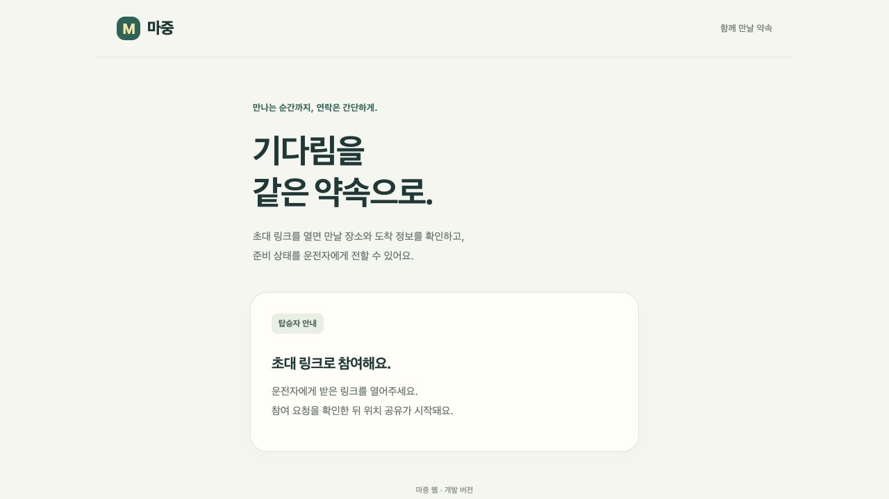

# 외부 접속 전 서버 준비

현재 단계는 배포 준비 코드와 로컬 검증이다. GCP 서버·도메인·HTTPS가 이미 만들어졌다는 뜻은 아니다.
처음에는 초대한 사람만 사용하는 제한된 시험으로 진행한다.

## 로컬 설정과 배포 설정

| 항목 | 기본 로컬 실행 | deploy 프로필 |
| --- | --- | --- |
| 바인딩 | 127.0.0.1 | 127.0.0.1, TLS 프록시 뒤에서만 사용 |
| DB | 파일 H2, Hibernate update | 환경변수의 PostgreSQL, 기존 스키마 validate |
| 픽업 생성 | 키 없이 허용 | X-Majung-Creation-Key 필수 |
| 웹 개발용 생성 화면 | 허용, 키 설정 시 숨김 | 숨김 |
| API 요청 제한 | 기본 켜짐 | 켜짐 필수 |
| 보관 데이터 정리 | 기본 꺼짐 | 켜짐 필수, 종료·만료 후 24시간 |

deploy 프로필은 32자 미만의 생성 키, 개발 도구 활성화, 요청 제한 또는 정리 작업 비활성화를 발견하면 시작하지 않는다.
클라이언트에 공개하는 `/api/v1/config`에는 개발 도구 허용 여부만 들어가며 비밀값은 보내지 않는다.
설정을 읽지 못한 웹도 개발용 생성 화면을 열지 않는다. 화면 숨김과 별개로 생성 API 자체에서 키를 검사한다.

로컬에서 배포 접근 제한을 켜고 확인한 홈 화면이다. GCP 배포 캡처는 아니다.



## 생성 키의 사용 범위

서버 관리자가 허용한 생성 요청에만 키를 붙인다. 기존 운전자·참여자 토큰과 별개이며 탑승자 참여·준비 상태·조회에 요구하지 않는다.
키는 **서버 측 관리 도구용 임시 접근 제한**이다. 사람·차량의 신원을 인증하는 기능은 아니다.
웹에 키 입력창을 만들거나 JS·Git·APK·캡처에 키를 넣지 않는다.

현재 차량 앱은 이 관리 키를 보내지 않으므로 deploy 서버의 생성 요청은 거절된다. 로컬 차량 시연에는 영향이 없다.
외부 차량 연동을 열기 전에는 짧은 수명의 생성 권한을 받는 차량 등록·인증 흐름을 연결해야 한다.
공유 키를 APK에 넣어서 외부 연결을 끝낸 것으로 처리하지 않는다.

## 요청 제한과 프록시

기본은 **접속 IP마다 1분에 전체 API 240회, 그중 변경 요청 90회**다. 초과 요청은 JSON 429와 `Retry-After: 60`을 반환한다.
고정 구간 방식이므로 구간 경계에서 순간 요청량이 커질 수 있다. 분산 제한이나 DDoS 방어를 구현한 것은 아니다.

카운터는 한 서버 프로세스의 메모리에만 존재한다. 최대 10,000개 접속 IP를 보관하고 만료 항목을 정리한다.
수용할 항목이 없으면 새 IP의 API 요청은 503으로 거절한다. 서버 재시작 시 초기화되며 여러 인스턴스 간 공유하지 않는다.
IP와 토큰을 제한 로그에 남기지 않는다.

`Forwarded`·`X-Forwarded-For`는 신뢰하지 않고 실제 소켓의 상대 주소를 사용한다.
따라서 TLS 프록시 뒤에서는 프록시 하나의 IP로 여러 사용자를 합산한다. 현재 소수 인원 시험에서는 보수적으로 합산하며,
인원이 늘면 신뢰할 프록시 범위와 프록시 측 제한을 함께 설계해야 한다. 헤더를 그대로 신뢰하도록 바꾸지 않는다.

TLS 프록시에서는 HTTPS 강제, 외부 8080 차단, JSON 요청 본문 크기 제한(예: 16KiB), 연결 시간 제한을 적용한다.
이번 변경은 프록시 설치나 인증서 발급을 수행하지 않았다.

## 비공개 설정과 시작 순서

1. JDK 25로 `./gradlew -p server test bootJar` 실행. 서버 바이트코드 대상은 Java 17이다.
2. 마중 전용 PostgreSQL DB와 계정을 만든다. 기존 다른 프로젝트의 DB·사용자·버킷을 재사용하지 않는다.
3. 빈 DB에서 [초기 스키마](../server/src/main/resources/db/initial-schema.sql)를 관리 계정으로 한 번 적용한다. 기존 DB에 반복 실행하거나 로컬 H2 파일을 덮지 않는다.
4. 앱 실행 계정에는 해당 테이블 SELECT·INSERT·UPDATE·DELETE 권한만 부여한다. 스키마 변경은 관리 계정으로 별도 수행한다.
5. [환경변수 예시](../deploy/server.env.example)를 저장소 밖 `/etc/majung/server.env`에 복사하고 소유자·권한을 제한한다. 실제 키·DB 암호를 채운다. `openssl rand -hex 32` 등으로 만든 무작위 생성 키를 사용한다.
6. [systemd 예시](../deploy/majung.service.example)의 사용자·Java 경로·JAR 경로를 서버에 맞춘 뒤 적용한다. 이 예시는 자동 설치 스크립트가 아니다.
7. 외부 공개 전에 localhost에서 시작·DB 연결·키 없는 생성 차단·탑승자 조회·정리 작업을 확인한다. 이후 TLS 프록시와 방화벽을 연결한다.

JAR 실행은 `java -jar`다. systemd의 EnvironmentFile이 값을 주입하며, 예시 env 파일을 쉘 스크립트처럼 실행할 필요는 없다.
Hibernate는 배포 DB 스키마를 자동 변경하지 않는다. 이후 엔티티 변경 시에는 마이그레이션 SQL·백업·복구 순서도 함께 준비한다.

## 보관과 삭제

deploy 설정에서는 5분마다 다음 행 전체를 삭제한다.

- 완료·취소 기록: `endedAt`부터 24시간 지난 행.
- 종료하지 않고 만료된 기록: `expiresAt`부터 24시간 지난 행.

경계 시각과 같아도 삭제 대상이다. 종료 기록에 `endedAt`이 있으면 그 시각을 기준으로 하며 이전 만료 시각으로 앞당기지 않는다.
살아 있는 픽업이나 보관 기간이 남은 픽업은 유지한다. 삭제 로그에는 개수만 남긴다.
삭제 후 과거 토큰으로 조회하면 더 이상 종료 안내도 찾을 수 없어 404가 된다.

24시간은 초기 시험용 기본값이다. 서비스 정책 확정 시 `MAJUNG_RETENTION_PERIOD`를 조정한다(최소 1시간).
정리 작업 주기 때문에 삭제가 최대 한 주기 늦을 수 있다. 프로세스가 중지된 동안은 정리하지 않으며 다시 실행하면 따라잡는다.
백업에 남은 데이터는 이 작업으로 지워지지 않으므로 별도 보관·삭제 기준이 필요하다.

## 백업·복구 절차

실제 PostgreSQL 백업·복구는 배포 DB를 만든 뒤 검증한다. 아래 절차는 준비안이다.
접속 정보는 권한을 제한한 libpq service 파일·passfile에 두고, 암호를 명령 인자나 저장소에 넣지 않는다.

```sh
# PGSERVICEFILE / PGPASSFILE은 저장소 밖의 비공개 파일 경로를 지정한다.
umask 077
PGSERVICE=majung_backup pg_dump --format=custom --file=/private-backup/majung.dump
pg_restore --list /private-backup/majung.dump

# 운영 DB 대신 새로 만든 격리 DB에 먼저 복구한다. --clean을 붙이지 않는다.
PGSERVICE=majung_restore pg_restore --exit-on-error --no-owner --no-privileges \
  --dbname=service=majung_restore /private-backup/majung.dump
```

초기 시험에서는 매일 백업·최대 7일 보관을 기준으로 준비하고, 암호화한 비공개 저장소에 서버와 분리해 둔다.
복구 DB의 행 수·앱 기동·기존 픽업 조회를 확인하고 정리 작업을 실행한 뒤 외부 연결한다.
오래된 백업을 복구하면 삭제한 기록도 되살아날 수 있다. 백업 자체의 만료와 복구 직후 정리를 함께 확인한다.
덤프 내용에는 위치·이름·토큰 해시가 포함되므로 공개 첨부나 Git 커밋을 하지 않는다.

## 검증 범위와 남은 작업

서버 시험 25개와 웹·초안 모델 13개를 통과했다. 기존 HTTP 흐름 외에 생성 키·설정 누출 방지·위조 프록시 헤더·요청 제한·동시 요청·정리 경계를 검증했다.
브라우저에서 기본 로컬 설정의 생성 폼과 제한 설정의 생성 화면 숨김도 직접 확인했다.
초기 SQL은 H2 PostgreSQL 호환 모드에서 생성 후 Hibernate validate와 실제 HTTP 흐름을 확인한다.
이 결과만으로 실제 PostgreSQL·GCP·TLS 프록시·백업 복구가 검증됐다고 판단하지 않는다.

다음은 전용 DB와 GCP 실행 환경 준비 → 차량 생성 권한 발급 흐름 → 도메인·HTTPS → 실제 휴대전화 시험이다.

설정 방식은 [Spring Boot 외부 설정](https://docs.spring.io/spring-boot/reference/features/external-config.html),
백업·복구 형식은 [PostgreSQL pg_dump](https://www.postgresql.org/docs/current/app-pgdump.html)와
[pg_restore](https://www.postgresql.org/docs/current/app-pgrestore.html)를 참고했다.
