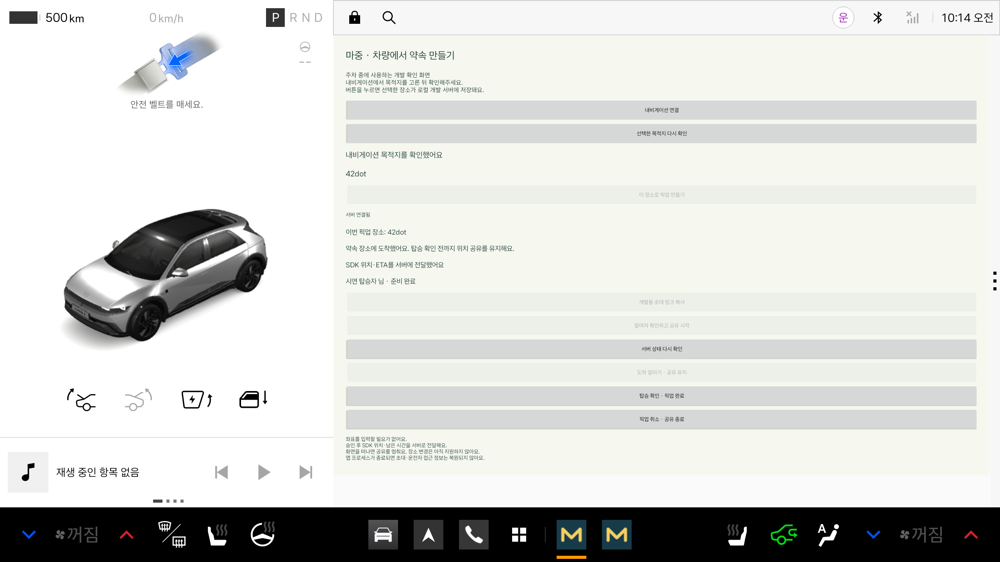
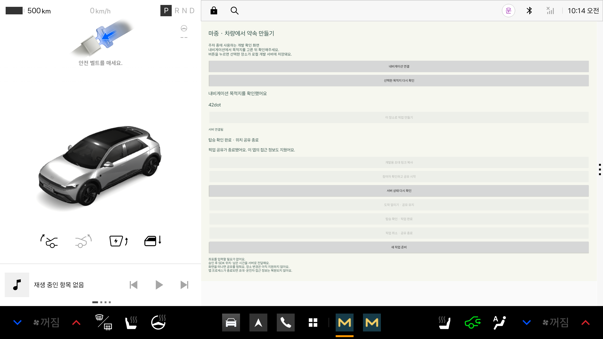

# 차량에서 도착을 알리고 픽업 완료하기

2026-10-23. 차량 앱에서 도착·탑승 완료 API를 호출하도록 연결했다. 공식 Pleos 에뮬레이터와 로컬 서버에서 확인했으며, 실차·실제 휴대전화 시험이나 주행 중 조작 허용 검증은 아니다.

## 동작

1. 참여 승인 후 `ACTIVE` 상태에서 ‘도착 알리기 · 공유 유지’를 누른다.
2. 약속 장소에 도착했는지 확인한다. ‘돌아가기’는 아무 요청도 보내지 않는다.
3. 서버 응답으로 `ARRIVED`가 확인되면 도착 안내와 탑승 완료 버튼을 표시한다. 위치·ETA 공유는 계속 유지한다.
4. 탑승자가 실제로 차에 탄 뒤 ‘탑승 확인 · 픽업 완료’를 누르고 확인한다.
5. 서버 응답이 `COMPLETED`이면 차량 정보 전송을 멈추고 앱의 운전자·초대 토큰, 참여자·픽업 장소를 지운다.
6. 탑승자 API는 종료된 픽업의 위치 조회와 준비 상태 변경을 410으로 거절한다. 상태 조회의 장소도 숨긴다. ‘새 픽업 준비’로 다음 약속을 시작할 수 있다.

도착 전에는 완료 버튼을 사용할 수 없다. 요청 중에는 도착·완료·취소의 중복 조작을 막는다.
연결 실패로 결과를 확인하지 못하면 완료됐다고 표시하지 않는다. ‘서버 상태 다시 확인’으로 서버 결과를 확인한 뒤 다음 동작을 진행한다.
기존 도착·완료 API는 같은 동작을 재요청할 수 있지만 완료된 픽업을 다시 활성화하지 않는다.

내비게이션 ETA가 0이 되거나 도착 콜백이 들어왔다는 이유만으로 탑승 완료를 실행하지 않는다.
현재는 주차 상태에서 운전자가 직접 확인하는 개발 화면이다. 실제 지도·장소 변경·백그라운드 공유·프로세스 종료 후 복구는 별도 작업이다.

## 실제 에뮬레이터 화면

공개 예제 목적지와 ‘시연 탑승자’ 이름으로 시험했다. 토큰·초대 링크 원문과 개인 위치 로그는 캡처하지 않았다.

도착 후 준비 상태와 공유 유지 안내:



탑승 확인 후 공유 종료·접근 정보 제거·새 픽업 준비:



## 확인 결과

| 항목 | 결과 |
| --- | --- |
| 도착·완료 확인 창에서 돌아가기 | 각각 ACTIVE·ARRIVED 유지 |
| 승인 전 도착·완료, 도착 전 완료 | 차량 동작 차단 |
| 도착 처리 | 서버 ARRIVED, 차량 상태 안내와 완료 버튼 활성화 |
| 도착 후 위치 조회 | FRESH 정보 조회 가능, 공유 유지 |
| 완료 처리 | 서버 COMPLETED, 탑승자 장소 비공개, 위치 조회·준비 상태 변경 410 |
| 완료 후 차량 동작 | 추가 전송·도착·완료 차단, 접근 정보 정리, 새 픽업 준비 가능 |
| 기존 생성·승인·SDK 해제·재연결·준비 상태·취소 | 회귀 시험 통과 |
| 공식 에뮬레이터 통합 시험 | 2개 통과 |
| 차량 단위 / 서버 HTTP / 웹 모델 시험 | 8개 / 14개 / 13개 통과 |
| debug APK·시험 APK·lint | 빌드 성공, lint 오류 0건·기존 경고 4건 |

통합 시험은 실제 NaviHelper 응답과 실제 로컬 HTTP 서버를 사용한다. 단위 시험으로 SDK 응답을 흉내 낸 결과와 구분한다.
서버 HTTP 시험에는 종료와 위치 전송이 겹쳐도 종료 후 정보가 남지 않는 검사도 포함한다.
통신 장애·응답 유실을 새로 주입한 시험은 이번에 추가하지 않았다. 응답 확인 실패 시 재조회 처리는 기존 요청 처리 흐름을 사용한다.

## 재현

[차량 앱 실행](vehicle-pickup.md)대로 로컬 서버와 공식 Pleos AVD의 선택 목적지를 준비한다.

```sh
./gradlew :vehicle:assembleDebug :vehicle:assembleDebugAndroidTest :vehicle:testDebugUnitTest :vehicle:lintDebug
adb install -r vehicle/build/outputs/apk/debug/vehicle-debug.apk
adb install -r vehicle/build/outputs/apk/androidTest/debug/vehicle-debug-androidTest.apk
VEHICLE_USER=$(adb shell am get-current-user | tr -d '\r')
adb shell am instrument --user "$VEHICLE_USER" -w -r \
  -e class app.majung.vehicle.VehiclePickupTest \
  app.majung.vehicle.test/androidx.test.runner.AndroidJUnitRunner
```

`arriveAndCompletePickupFromVehicleScreen`은 차량 버튼·확인 창을 통해 진행하고, `createPickupFromNavigationAndApprovePassenger`는 기존 SDK·취소 흐름을 확인한다.
공개 예제만 사용하는 로컬 시험에서 `-e captureEvidence true`를 추가하면 앱 내부에 `vehicle-arrived.png`·`vehicle-completed.png`를 저장한다.
기본 시험은 이미지를 남기지 않는다. 자동 화면 캡처는 연속 시연 영상과 다르며, 전체 흐름 녹화와 HTTPS·실제 휴대전화 시험은 다음 단계다.
