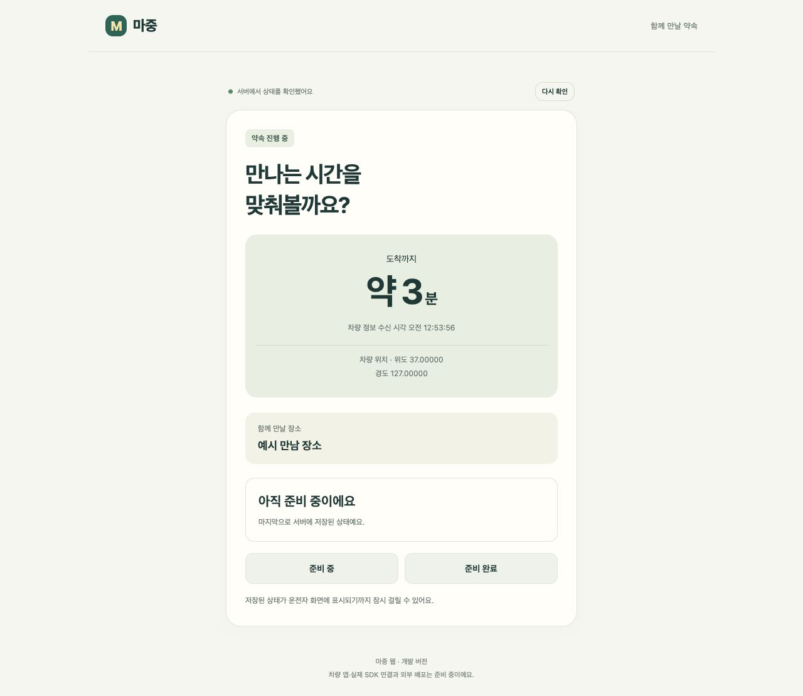
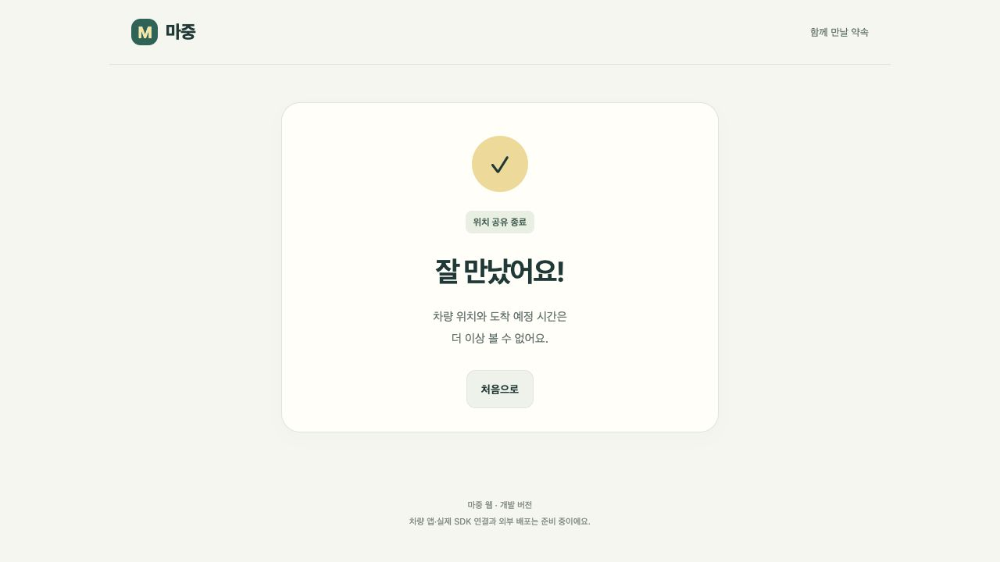

# 탑승자 웹 연결

## 지금 되는 흐름

서버를 실행하고 `http://127.0.0.1:8080/`을 열면 API와 연결된 웹을 사용할 수 있다.
기존 `design/prototype`은 예시 데이터를 사용하는 화면 초안으로 그대로 남겨뒀다.

1. ‘운전자 확인 화면’에서 픽업을 만든다. 차량 앱 연결 전 개발 확인용 화면이다.
2. 초대 화면을 새 탭으로 연다. 탑승자는 이름만 입력한다. 위치 권한이나 좌표 입력은 없다.
3. 운전자 탭에서 참여자를 확인하고 공유를 시작한다. 승인 전에는 장소와 차량 정보가 보이지 않는다.
4. 탑승자 탭에서 준비 중·준비 완료를 선택한다. 운전자 화면은 서버에 저장된 상태를 조회한다.
5. 운전자가 도착을 알린 뒤 탑승을 확인하면 픽업이 완료된다. 탑승자 화면도 공유 종료로 바뀐다.

상태는 3초마다 확인한다. 탭을 숨기면 조회를 멈추고, 다시 열면 정보를 새로 조회한다.
버튼의 ‘저장 완료’는 서버 저장 결과이며 차량 앱 수신 확인을 뜻하지 않는다.

## 장소 입력을 어떻게 바꿀지

위도·경도 입력은 운전자용 개발 확인 화면에만 있다. 탑승자에게 좌표를 입력받는 흐름은 아니다.
개발용 차량 앱은 내비게이션에서 선택한 장소로 픽업을 생성하도록 연결했다. [차량 앱 안내](vehicle-pickup.md)를 참고한다.
탑승자의 장소 제안을 추가한다면 장소 검색·지도 선택으로 처리한다. 검색·지도 기능은 아직 없다.

## 차량 정보와 연결 끊김

차량 SDK의 목적지로 픽업을 만드는 부분은 연결했다. 차량 위치·ETA 자동 전송은 아직 연결하지 않았다.
차량 정보가 없으면 대기 안내를 표시한다. 예시 ETA를 대신 표시하지 않는다.
API 응답의 `validForMillis`에서 요청 왕복 시간을 뺀 뒤, 브라우저의 단조 증가 시간을 기준으로 만료시킨다.
휴대전화의 날짜·시각이 틀려도 이 유효 시간 계산에는 영향을 주지 않는다.
조회 실패·탭 복귀·만료 때는 이전 위치와 ETA를 숨긴다. 현재 지도는 없으며 위치 숫자는 개발 확인용이다.

## 초대·세션 처리

- 초대 토큰은 URL fragment로 전달하고 진입 즉시 주소에서 지운다. query나 API 경로에 넣지 않는다.
- 운전자·참여자 토큰은 해당 탭의 `sessionStorage`에 저장한다. 새로고침 후 복원하며, 완료·취소·만료·접근 거절 때 지운다.
- 초대 발급 전용 화면은 별도의 서버 로그인 없이 개발 흐름을 확인하기 위한 것이다. 지금 상태로 인터넷에 공개하면 안 된다.
- 서버가 웹 파일도 제공한다. 외부 스크립트·폰트·분석 도구·지도 요청은 없고 CSP는 같은 출처의 파일·통신만 허용한다.
- 초대 링크와 개발자 도구에 보이는 토큰을 캡처·문서·로그에 남기지 않는다.

## 확인 결과

- 브라우저: 생성 → 별도 탭 참여 → 승인 전 장소·차량 정보 비공개 → 운전자 승인 → 준비 완료 저장·운전자 반영 → 새로고침 후 복원 확인.
- 예시 좌표를 API로 전송해 브라우저의 ETA 표시와 30초 경과 후 정보 숨김 확인. 도착·완료 API 호출 뒤 공유 종료 화면으로 자동 전환 확인.
- 서버 HTTP 시험 13개: 권한·만료·재전송·동시 요청·종료 후 접근 차단 포함.
- Node 시험 13개: 기존 화면 모델 8개와 실제 웹 모델 5개. 초대 형식·세션 검증·유효 시간·표시 제한·입력 이스케이프 확인.
- 패키징된 웹 파일의 응답·CSP·캐시 제한, HTTP 기본 흐름 6단계 확인.

실제 휴대전화·차량 앱에서의 통신, 외부 HTTPS 배포, 지도 표시, 네이티브 탑승자 앱은 미확인·미구현이다.

## 실행 화면

아래 좌표와 장소는 검증용 예시다. 차량 SDK가 보낸 실제 위치가 아니다.
서버에 예시 차량 정보를 전송한 뒤 브라우저가 API로 조회한 화면이다.

